<!-- TODO(images): add project logo here, e.g.  -->

# ESP32 SkippersWatch

[](https://www.espressif.com/en/sdks/esp-arduino)
[](https://docs.waveshare.com/ESP32-S3-Touch-AMOLED-2.06)
[](https://www.espressif.com/en/solutions/low-power-solutions/esp-now)
[](#power-management)
[](LICENSE)
[](https://lvgl.io)

## Disclaimer

This is a personal hobby project. It is provided "as is", without warranty of any kind. See LICENSE.

This firmware is NOT intended for navigation or for any safety-critical use at sea. Do not rely on the data it produces (such as heading, depth or position) to navigate a vessel. Always use certified navigation equipment and proper seamanship.

You use this code entirely at your own risk. The author accepts no liability for any damage, injury or loss arising from its use.

## Introduction

A wrist-worn marine instrument for the [Waveshare ESP32-S3-Touch-AMOLED-2.06](https://docs.waveshare.com/ESP32-S3-Touch-AMOLED-2.06) watch board (SKU 31957: ESP32-S3, 410×502 AMOLED touchscreen, AXP2101 PMIC, LiPo, factory case with strap). It is the battery-powered sibling of my always-on [ESP32-Crowpanel-compass](https://github.com/mkvesala/ESP32-Crowpanel-compass) helm display — same receive-only ESP-NOW architecture, but rationed to run for a day or more on a small battery and charged nightly.

> **v2.0.0 is the Waveshare port.** v1.0.0 ran on the [Elecrow CrowPanel 2.01" Watch Display](https://github.com/Elecrow-RD/CrowPanel_2.01_inch-HMI_ESP32_Watch_Display_240_296) (240×296 IPS, rotary knob); that build is kept as tag `v1.0.0` and on the `legacy/crowpanel` branch. The repository was renamed from `ESP32-Crowpanel-SkippersWatch` to `ESP32-Waveshare-SkippersWatch` after v2.0.0; GitHub redirects the old URLs.

Receives via ESP-NOW broadcast:
- GNSS position, speed over ground (SOG), course over ground (COG) and **UTC date/time** from [UBLOX-ESP32-SignalK-gateway](https://github.com/mkvesala/UBLOX-ESP32-SignalK-gateway)
- Water depth (below surface / transducer / keel), relayed from SignalK by a temporary depth sender (private, not published)
- Pitch and roll from [CMPS14-ESP32-SignalK-gateway](https://github.com/mkvesala/CMPS14-ESP32-SignalK-gateway)
- House and starter battery from [VEDirect-ESP32-SignalK-gateway](https://github.com/mkvesala/VEDirect-ESP32-SignalK-gateway)
- Temperature, air pressure and relative humidity from [BME280-ESP32-SignalK-gateway](https://github.com/mkvesala/BME280-ESP32-SignalK-gateway)
- Engine exhaust temperature, fuel tank and fresh-water tank levels from [HALMET-ESP32-SignalK-gateway](https://github.com/mkvesala/HALMET-ESP32-SignalK-gateway)

Values are shown on an LVGL UI. Interaction is by **capacitive touch**: swipe left / right through the screens, swipe down for a page menu, swipe up for a status screen, tap and slider drag. The **PWR button** wakes the watch from deep sleep (see [Input](#input)).

Screens (carousel, plus a page menu for direct access):
- **Navigation** — POS (lat/lon), true heading (HDG), COG, SOG, depth below surface (DPT)
- **Batteries** — house voltage / current / SoC and starter voltage
- **Weather** — temperature, air pressure, relative humidity
- **Engine** — exhaust temperature, fuel and fresh-water tank litres
- **Attitude** — artificial horizon with pitch and roll
- **Clock** — local date + weekday, local and UTC time (GNSS-disciplined, no RTC chip, no NTP)
- **Setup** — display brightness, wake time, prevent sleep, demo mode and night mode, all persisted to NVS

Developed on:
- [Waveshare ESP32-S3-Touch-AMOLED-2.06](https://docs.waveshare.com/ESP32-S3-Touch-AMOLED-2.06) (SKU 31957)
- [ESP32 board package](https://github.com/espressif/arduino-esp32) (3.3.11)
- [Arduino IDE](https://www.arduino.cc/en/software/) (2.3.x)
- [LVGL](https://lvgl.io/) (9.5)
- [Arduino GFX Library](https://github.com/moononournation/Arduino_GFX) (1.6.7, `Arduino_CO5300` driver)
- [XPowersLib](https://github.com/lewisxhe/XPowersLib) (0.3.3, AXP2101 PMIC)
- [SquareLine Studio](https://squareline.io/) for UI design

Integrated via ESP-NOW with:
- [UBLOX-ESP32-SignalK-gateway](https://github.com/mkvesala/UBLOX-ESP32-SignalK-gateway) — GNSS + UTC date/time sender
- A temporary, private depth sender — depth relay from SignalK (not published)
- [CMPS14-ESP32-SignalK-gateway](https://github.com/mkvesala/CMPS14-ESP32-SignalK-gateway) — attitude sender
- [VEDirect-ESP32-SignalK-gateway](https://github.com/mkvesala/VEDirect-ESP32-SignalK-gateway) — battery sender
- [BME280-ESP32-SignalK-gateway](https://github.com/mkvesala/BME280-ESP32-SignalK-gateway) — weather sender
- [HALMET-ESP32-SignalK-gateway](https://github.com/mkvesala/HALMET-ESP32-SignalK-gateway) — engine, fuel and fresh-water sender

## Purpose of the project

This is one of my individual digital boat projects. Use at your own risk. Not for safety-critical navigation.

1. I wanted a glanceable, wrist-worn repeater of the boat's key instruments, independent of WiFi and SignalK, that survives days on a tiny battery
2. I wanted to solve the core tension of a battery ESP-NOW device: **you cannot deep-sleep and listen at the same time** — the radio is off in deep sleep, so no packet can arrive
3. I continued learning ESP32 C++ patterns, LVGL and low-power design, reusing the architecture of the companion compass project

## Project status

**Version 2.0.0** (2026-10-23) — see [CHANGELOG.md](CHANGELOG.md).

Port to the Waveshare AMOLED board: the full v1.0.0 feature set plus the [page menu](#input), the [status screen](#status-screen), the [startup screen](#startup-screen), [demo mode and night mode](#setup-screen) and an adjustable wake time, flashed and running correctly on the board. The board's own current measurements (sleep floor, active draw) are still open. Until they are measured, no endurance figures are claimed for this board (see [Power management](#power-management)).

**Version 1.0.0** (CrowPanel 2.01") ran on hardware on the vessel with all seven screens, the GNSS-disciplined clock, the touch UI and a measured, closed power budget.

## Classes

<!-- TODO(diagram): add class / UML diagram here, e.g.  -->

**`WatchApplication`:**
- Owns: `Arduino_ESP32QSPI`, `Arduino_CO5300`, `PanelBrightness`, `ESPNowReceiver`, `NavigationUI`, `BatteryUI`, `WeatherUI`, `EngineUI`, `AttitudeUI`, `ClockUI`, `SetupUI`, `CelestialUI`, `MenuUI`, `TouchInput`, `ScreenManager`, `PowerManager`, `BatteryMonitor`, `DemoSource`, `ThemeController`, `SystemStats`, `StatusUI`
- Responsible for: orchestrating everything within the main program, including the staggered wake sequence (with the startup screen on a true power-on), gesture dispatch (carousel and page menu), GNSS time discipline and applying Setup's demo and night switches

**`PowerManager`:**
- Uses: `BatteryMonitor` (read-only, for the low-charge ladder and the USB stay-awake rule), `PanelBrightness`, `TouchInput` (hibernate) and the panel (sleep) at sleep entry
- Responsible for: Model B deep-sleep power ownership — display-on timeout, putting the panel and touch to sleep + GPIO holds on sleep entry, PWR-button wake arming — and for all policy that can force a sleep decision: the absolute awake ceiling, the task watchdog, the low-charge ladder and the stuck-wake-button guard (see [Power guards](#power-guards))
- Owned by: `WatchApplication`

**`BatteryMonitor`:**
- Uses: `XPowersAXP2101` (XPowersLib)
- Responsible for: reading the watch's own LiPo from the AXP2101 PMIC (voltage, EMA smoothing, fuel-gauge state-of-charge with a LiPo resting curve as fallback), VBUS detection, driving the status-bar indicator, and classifying the charge into the `OK` / `WARN` / `CRITICAL` / `CUTOFF` level the power ladder acts on. Data only — the policy lives in `PowerManager`
- Owned by: `WatchApplication`

**`ESPNowReceiver`:**
- Responsible for: receiving `GnssDelta`, `DateTimeDelta`, `HeadingDelta`, `BatteryDelta`, `WeatherDelta`, `HALMETEngineDelta`, `HALMETTankDelta`, `HALMETWaterDelta` and `DepthDelta` broadcasts (receive-only), with per-source RX timestamps for freshness
- Owned by: `WatchApplication`

**`TouchInput`:**
- Uses: `Ft3168Touch` (local FT3168 driver), `GestureClassifier`
- Responsible for: polling the capacitive touch panel and recognizing gestures in software (tap / swipe left / right / up / down; long-press reserved), plus absolute slider drags; hibernating the controller before deep sleep
- Owned by: `WatchApplication`

**`MenuUI`:**
- Responsible for: the page menu overlay (`ui_ContainerMenu`, one image button per screen): show / hide and hit-testing a tap to a screen index. Not an `IScreenUI` page — never part of the carousel or the last-active store
- Owned by: `WatchApplication`

**`DemoSource`:**
- Uses: `ESPNowReceiver`, `DemoValues` (pure value generator, host-tested)
- Responsible for: demo mode's data — made-up but plausible values packed into real ESP-NOW frames and injected into the receiver, so the screens show them through their normal freshness logic
- Owned by: `WatchApplication`

**`ThemeController`:**
- Uses: `NightPalette` (pure, host-tested), `BatteryMonitor`, `MenuUI`
- Responsible for: switching the day / night palette — the theme's screen colors and inherited text color, the status-bar frame, and telling the other color owners to repaint (battery bar) or swap artwork (menu icons)
- Owned by: `WatchApplication`

**`SystemStats`:**
- Uses: `StatusFormat` (pure, host-tested)
- Responsible for: the Status screen's data — uptime from the RTC timer, and power-on counters (wake-ups, total awake time, ESP-NOW frames, unexpected resets) in `RTC_NOINIT` memory, plus this wake's loop runtime
- Owned by: `WatchApplication`

**`StatusUI`:**
- Uses: `SystemStats`, `BatteryMonitor`, `ESPNowReceiver` (frame count)
- Responsible for: the Status overlay (`ui_ContainerStatus`): show / hide and a once-per-second refresh of its values. Not an `IScreenUI` page — never part of the carousel or the last-active store
- Owned by: `WatchApplication`

**`PanelBrightness`:**
- Responsible for: AMOLED brightness as a panel command (0..255), remembering the last level sent; shared by `SetupUI` and `PowerManager`
- Owned by: `WatchApplication`

**`IScreenUI`:**
- Abstract base class for all UI adapter class implementations: `onButtonPress()` (tap) plus `interceptsTouchAt()` / `onTouchDrag()` / `onTouchEnd()` (touch drag)

**`NavigationUI` / `BatteryUI` / `WeatherUI` / `EngineUI` / `AttitudeUI` / `ClockUI` / `SetupUI`:**
- Realize: `IScreenUI`
- Use: `ESPNowReceiver` (all data screens); `ClockUI` reads the ESP32 system clock; `SetupUI` uses `Preferences` (NVS)
- Responsible for: updating the LVGL objects of their container from the relevant data source, showing placeholders until a fresh packet arrives
- Owned by: `WatchApplication`

**`CelestialUI`:**
- Realizes: `IScreenUI`
- Owns: `CelestialEngine`
- Uses: `ESPNowReceiver` (position, weather, time freshness), the ESP32 system clock, `CelestialFormat` (pure, host-tested)
- Responsible for: the Celestial screen's table (body, Hc, Zn) and its variables (UTC, pressure, temperature, position), redrawn once per UTC second; no bodies without fresh time and position
- Owned by: `WatchApplication`

**`CelestialEngine`:**
- Uses: `CelestialCalculator`, `CelestialSelector`, `NavStars`
- Responsible for: the astronomy off the UI loop — a FreeRTOS task on core 0 that computes once per second, only while the Celestial screen is open and being updated; blocked on a notification otherwise. Inputs and results are exchanged under a spinlock
- Owned by: `CelestialUI`

**`CelestialCalculator` / `CelestialSelector`:**
- Use: Astronomy Engine (`astronomy.c`), `NavStars` (the 57 Nautical Almanac stars, Hipparcos)
- Responsible for: geocentric Hc / Zn of Sun, Moon, planets and stars (double precision, proper motion applied), rise / set and twilight tests; picking the twilight set (planet + two stars, or three stars, ~120° apart). Pure, host-tested against JPL Horizons and SIMBAD (`tests/celestial/`)
- Owned by: `CelestialEngine`

**`ScreenManager`:**
- Depends on: `IScreenUI*`
- Responsible for: screen carousel management (containers on one LVGL screen, toggled via `LV_OBJ_FLAG_HIDDEN`), including direct jumps from the page menu
- Owned by: `WatchApplication`

## Features

> Each screen is shown as a pair: the SquareLine Studio preview of the 410×502 layout, and a photo of the watch running it.

Each screen is a container on a single LVGL screen. On wake, all cached values start as placeholders (`---` / `--.-`) and fill in only when a fresh ESP-NOW broadcast arrives — **stale data is never shown as if current** (see [Freshness](#freshness)).

### Status bar

Always visible above the screens: a bar and a percentage (`ui_LabelSoC`) showing the **watch's own LiPo** (distinct from the Batteries screen, which shows the boat's banks). Read from the AXP2101 PMIC every ~3 s: the cell voltage is EMA-smoothed, the state-of-charge comes from the PMIC's fuel gauge (a LiPo resting curve is the fallback, and both are logged so the gauge can be checked over a full discharge).

| Indicator | Meaning |
|---|---|
| Green | above 40 % |
| Amber | above 20 %, up to 40 % |
| Red | 20 % or below — the low-charge ladder is active (see [Power guards](#power-guards)) |
| Blue, full | on USB power (AXP2101 VBUS present); the charger-elevated cell voltage is meaningless for SoC, so the bar is not estimated while charging. The percentage keeps showing the fuel gauge's live value, so charging progress is visible |

In demo mode the percentage reads e.g. `80 % DEMO`. The bar, the percentage and the low-charge ladder always use the real cell, demo or not. In night mode the bar keeps its four states as shades of red (charging and ≤ 20 % brightest).

### Navigation screen

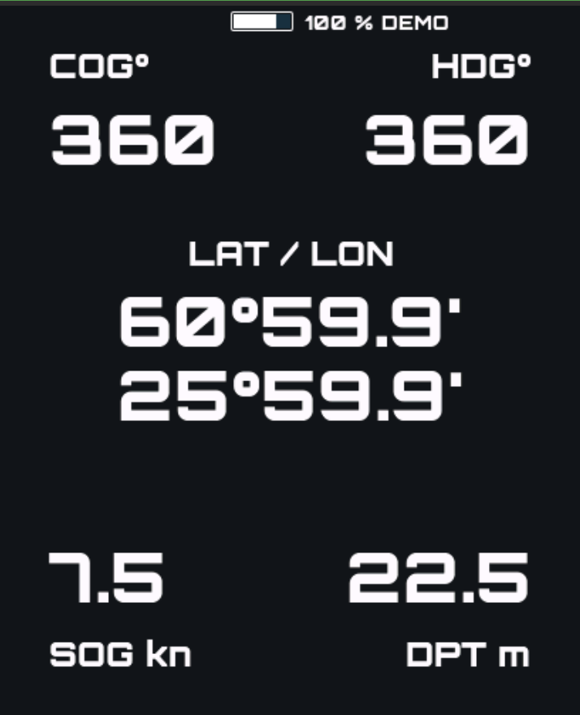 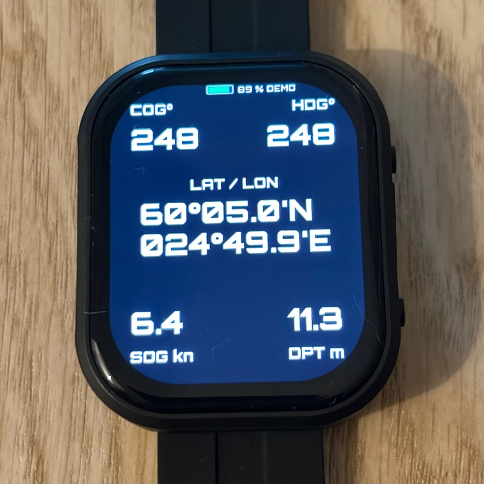

- **POS** — latitude / longitude, shown only with a valid GNSS fix (blank until fix)
- **HDG** — heading, **true** (`heading_true_x10` from the CMPS14 sender, which applies the variation). Deliberately true rather than magnetic so it is directly comparable with the true COG beside it — a magnetic HDG next to a true COG reads as a ~11° crab angle that is not there
- **COG** — course over ground, true. `hasCog()`-gated: shown only when moving; blank at anchor (a stationary boat has a valid fix but undefined course)
- **SOG** — speed over ground in knots
- **DPT** — depth below surface (`below_surface_m`), the chosen single reference. Uses two-fold freshness: the ESP-NOW RX timestamp AND the depth payload's own `age_ms` (feed liveness) — either stale or NaN → `--.-`

### Batteries screen

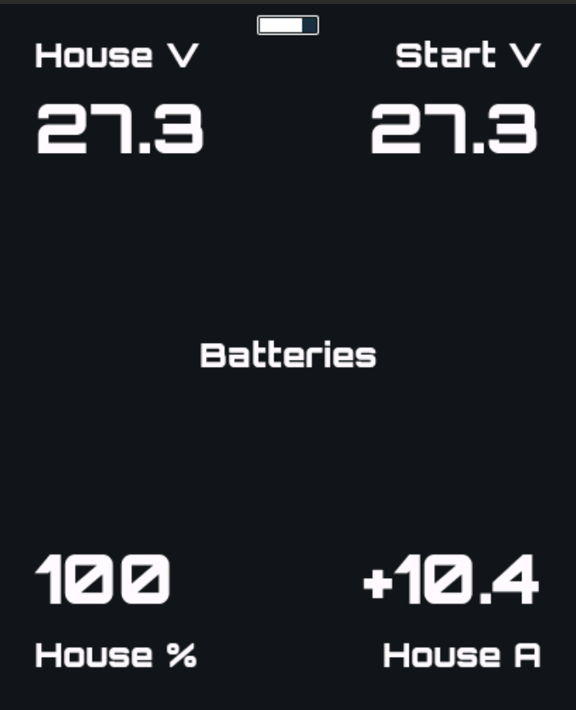 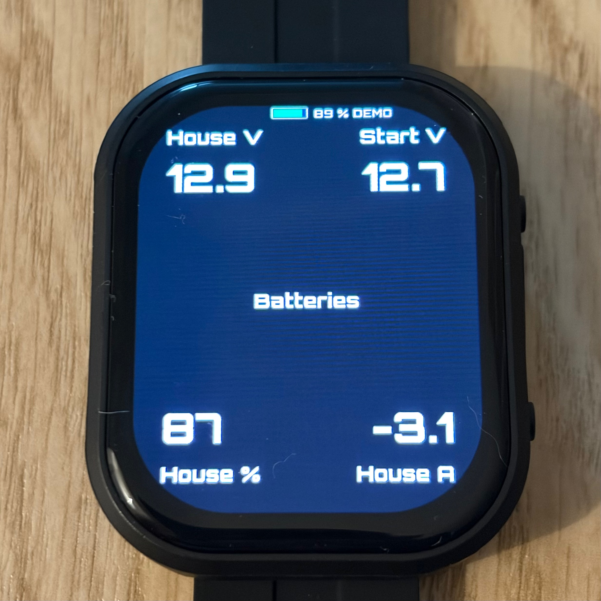

- House bank voltage, current (negative = charging) and state-of-charge
- Starter battery voltage
- Source: `BatteryDelta` from a VE.Direct-based sender

### Weather screen

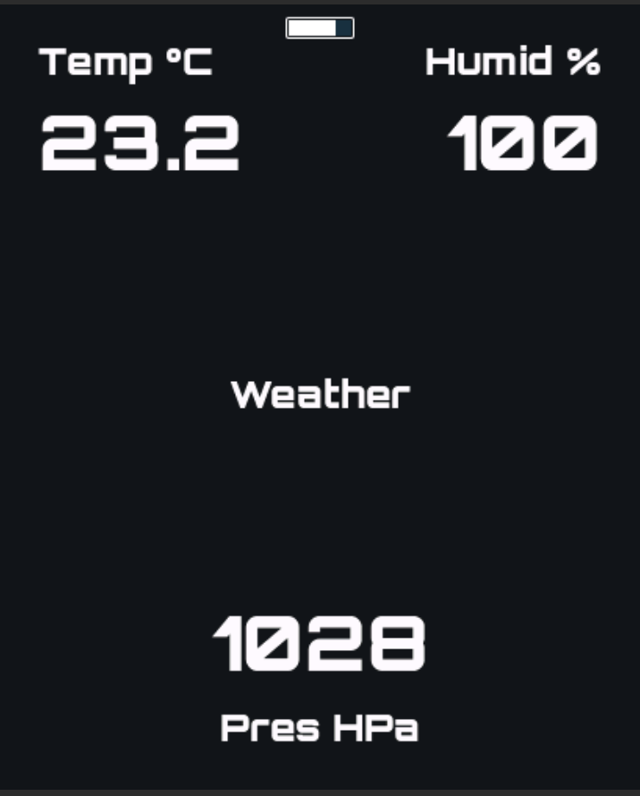 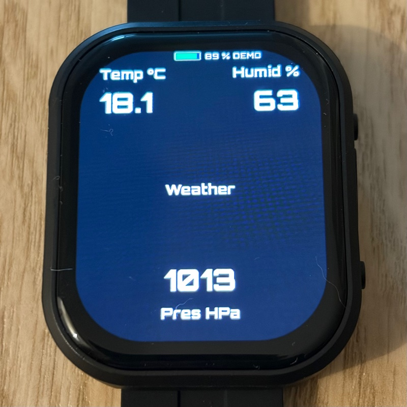

- Temperature (°C), air pressure (hPa), relative humidity (%)
- Source: `WeatherDelta` from a BME280-based sender

### Engine screen

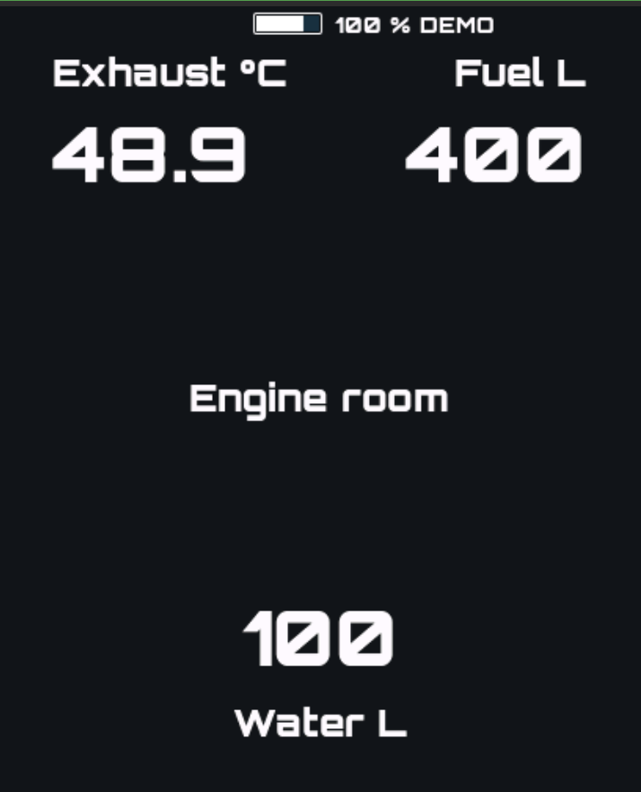 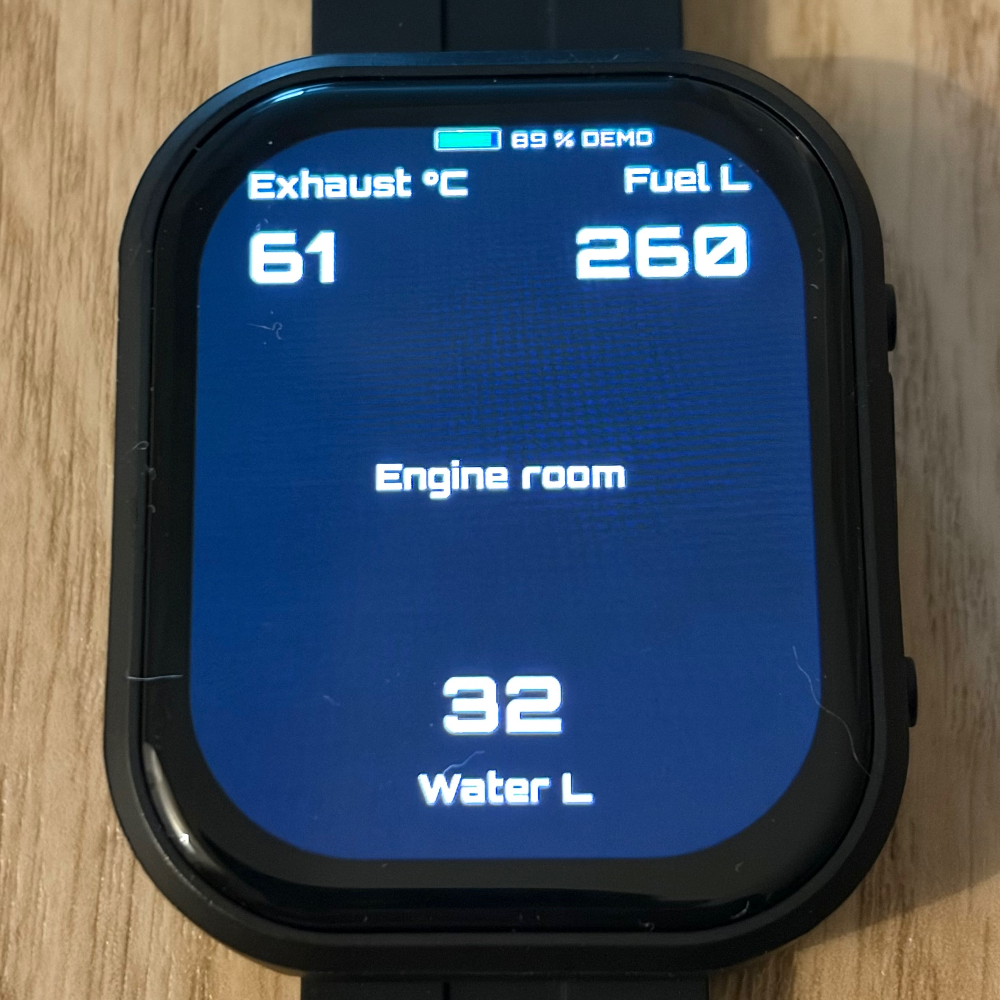

- Exhaust temperature (°C, converted from Kelvin)
- Fuel tank litres and fresh-water tank litres (ratio × capacity; tank capacities are constants in `EngineUI.h`, on the vessel: fuel 400 L, water 80 L)
- Sources: `HALMETEngineDelta`, `HALMETTankDelta`, `HALMETWaterDelta`

### Attitude screen

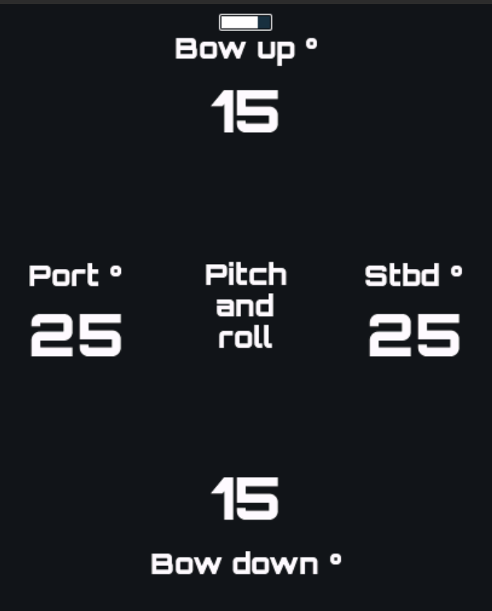 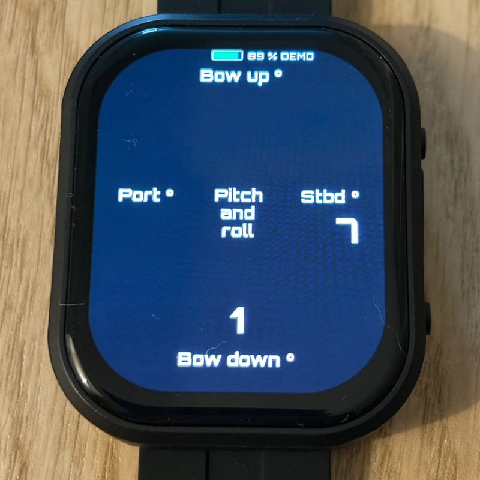

- Artificial horizon plus pitch and roll value labels
- Source: `HeadingDelta` (pitch/roll) from the CMPS14 compass sender
- Session min/max markers were removed: the watch only receives packets during its short awake windows, so an extreme reached while it slept could never be observed. A meaningful "worst heel this trip" belongs in the always-powered CMPS14 gateway, not here

### Clock screen

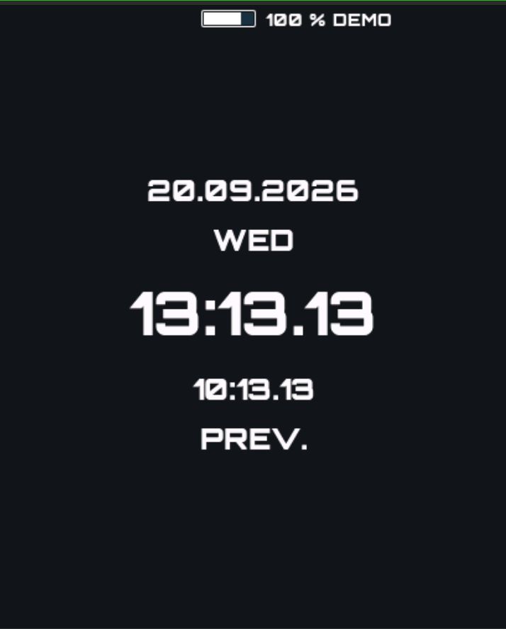 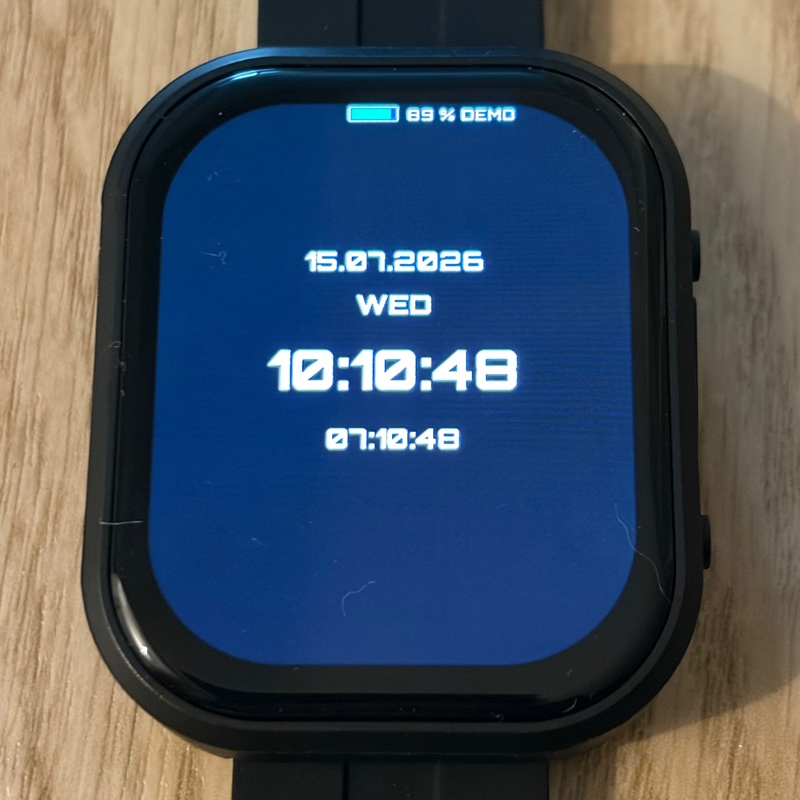

- Local date `DD.MM.YYYY`, English 3-letter weekday
- Local and UTC time `HH:MM:SS` (24 h); a `PREV.`/`NEXT.` indicator appears under UTC when its calendar day differs from local
- **Timekeeping is ESP32-internal POSIX time** (`time.h`), Finland timezone `EET-2EEST,M3.5.0/3,M10.5.0/4`, disciplined by GNSS UTC over ESP-NOW (`DateTimeDelta` → `settimeofday()`). Survives deep sleep for free via the RTC timer
- Shows placeholders until synced (system year ≥ 2020) — a fabricated time is never displayed. No external RTC chip (PCF8563 deferred), no NTP (deliberately — no internet at anchor)
- Demo mode is the only exception: with no synced time it shows a made-up time ticking from 10:10:00. The system clock is never changed by it, and real GNSS time keeps being applied in demo mode

### Setup screen

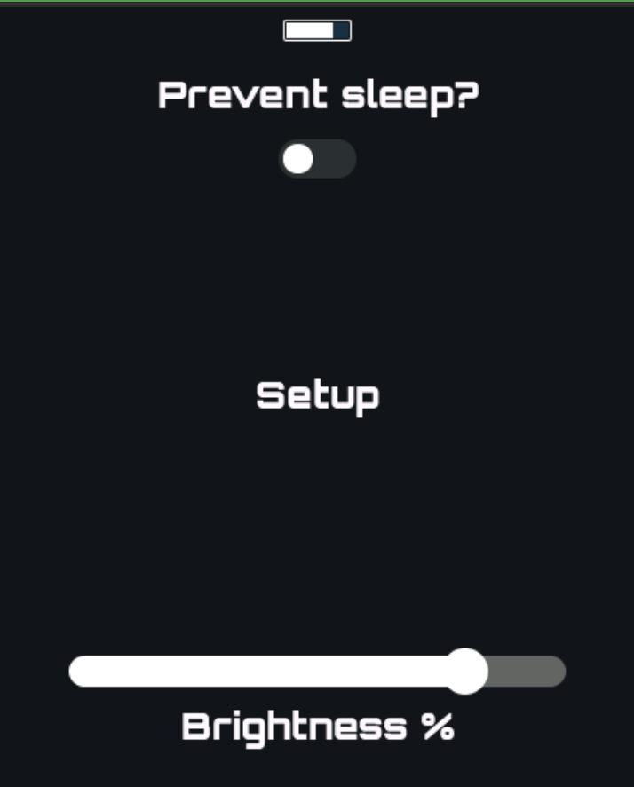 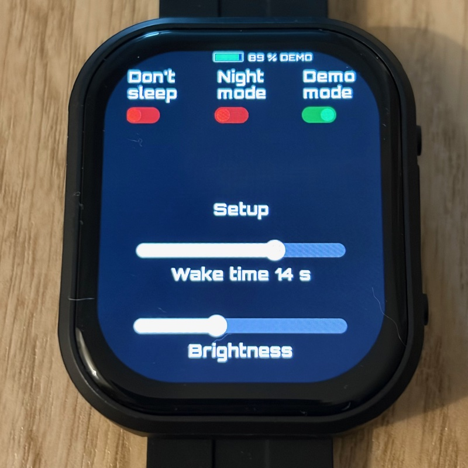

**Touch-only**, like the rest of the UI. Two sliders and three switches; every setting is saved to NVS (namespace `"display"`). The slider position and the switch colour show the state directly, so the SquareLine value labels are hidden and never written — except the wake time label, which reads `Wake time N s`. All three switches share the same look: red knob = off, green = on.

**Display brightness** (`ui_SliderBrightness`) — drag the slider; applies instantly, saves to NVS on release. Range 2 %–100 % (the 2 % minimum keeps the screen from going fully dark); default 20 % (readable in daylight, low continuous draw), with the NVS-stored value always winning. Persistence: namespace `"display"`, key `"brightness"`. The AMOLED has no backlight: brightness is a panel command (CO5300 `0x51`, 0..255) sent by `PanelBrightness`.

The power layer may apply a **ceiling** on top of the slider (low battery, or the stay-awake idle dim). It clamps only what reaches the panel, never the stored setting, so the slider keeps showing your choice and it is restored the moment the ceiling lifts.

**Prevent sleep** (`ui_SwitchPreventSleep`) — tap to keep the watch awake on battery, the same way it stays awake while docked on USB: no display timeout, and the panel dims to 5 % after 60 s of no input instead of sleeping. Persistence: namespace `"display"`, key `"nosleep"`, saved the instant you flip it (`onLeave()` never runs on the way into deep sleep, so a later save would lose it). Red knob = off, green = on.

Two limits still apply, deliberately:

- **The 120 s awake ceiling is not suspended.** The switch suspends the display timeout, never the ceiling, so an awake session stays bounded — see [Power guards](#power-guards). USB is the only mode that lifts the ceiling, because on external power there is no endurance to protect.
- **The low-charge ladder overrides it from `CRITICAL` down** (SoC ≤ 10 %): the normal 3 s timeout and the 10 % brightness clamp come back. Your stored setting is not rewritten, so prevent sleep resumes by itself once the cell recovers — the same principle as the brightness ceiling.

**Cost.** With the switch on, every wake runs the full 120 s instead of timing out — on the CrowPanel that was roughly **11× a normal glance**. It is a "keep it awake while I am actively using it" switch, not a set-and-forget setting. The figure for the AMOLED board follows from its own active-current measurement (still open).

**Wake time** (`ui_SliderWaketime`) — how long the screen stays on after the last touch before the watch goes back to deep sleep: 2–20 s, default 10 s. Key `"waketime"`. The low-charge ladder still caps it (5 s at `WARN`, 3 s from `CRITICAL` down) but never lengthens a shorter choice. While prevent sleep is on there is no timeout to set, so the slider is greyed out and ignores touch.

**Demo mode** (`ui_SwitchDemoMode`) — every screen shows made-up but plausible values instead of the ESP-NOW data, for showing the watch away from the boat. Key `"demo"`. The radio keeps listening and parsing exactly as normal, so battery behaviour is the same as with real data; received frames are simply not stored. The receiver keeps one fixed slot per message type with no queue or heap, so nothing received accumulates. Switching either way clears every source, so the screens show placeholders until the new source delivers: a demo value can never pass for a real one, or the other way round. The status bar shows `DEMO`.

**Night mode** (`ui_SwitchNightMode`) — everything on the panel is drawn in shades of red to keep the eyes dark-adapted: text, the status bar, sliders and switches, and the menu shows a separate set of red icons drawn in SquareLine (`ui_ImgButton*Night`, stacked on the day icons; one set is visible at a time). Key `"night"`. Applied before the first frame of a wake, so a night wake never flashes white. Black stays true black. Colors are mapped by brightness (`NightPalette`); the ones whose meaning is their hue (battery-bar states, switch on/off) use explicit red shades so they stay distinguishable. On the AMOLED, red-only drives only the red subpixels, so night mode should also draw less current (to be measured).

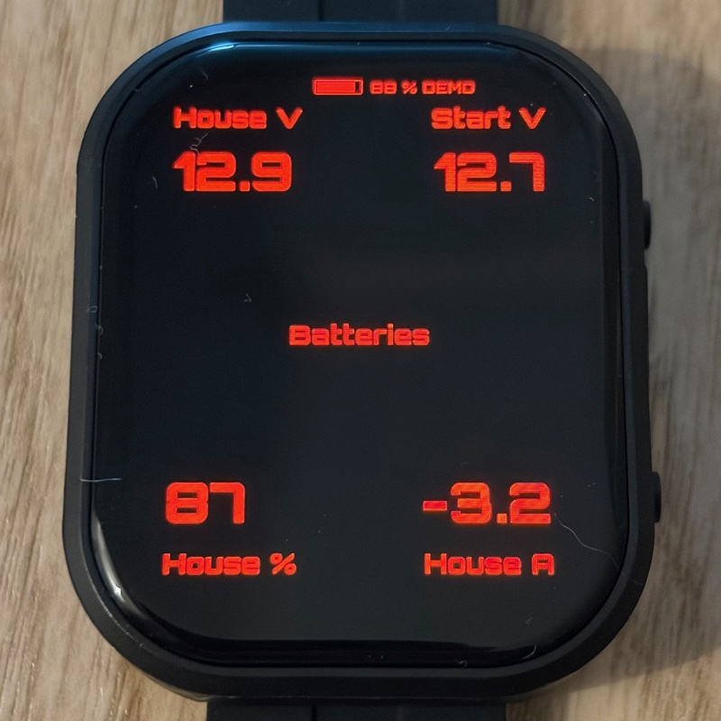 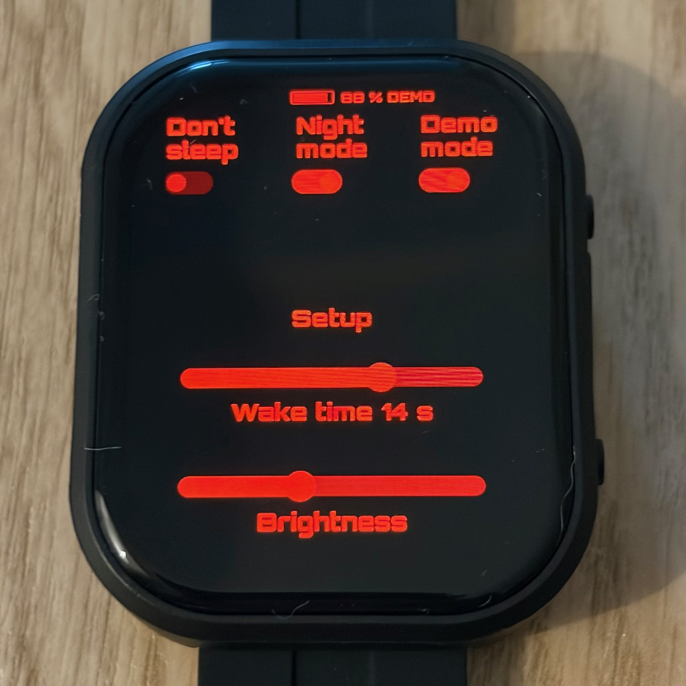 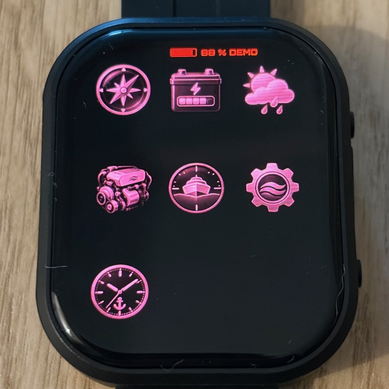

### Celestial screen

<!-- TODO(screenshot): docs/celestial.png (SquareLine) + docs/celestial.jpeg (on the watch) -->

A sight-reduction aid for sextant practice: the computed altitude **Hc** and true azimuth **Zn** of the bodies worth shooting right now, plus the other inputs of a manual sight reduction.

- **Table** (body / Hc `dd°mm.m'` / Zn `ddd°`, at most five rows):
  - **Sun** and **Moon** between their rise and set (upper limb on the sea horizon with standard refraction, as almanac rise/set)
  - **Twilight**, from the middle of civil twilight through the whole of nautical twilight (Sun Hc −3° … −12°): three more bodies, **one planet and two stars or three stars**, picked by `CelestialSelector` so their azimuths are ~120° apart, Hc 15°–65° preferred (10°–75° hard limits), brighter and away from the Moon preferred. The set is re-evaluated every 60 s with hysteresis, at once if a member leaves the window
  - Star names are abbreviated to six letters (`Betelg.`, `Arctur.`)
- **Variables** below the table: UTC time `HH:MM:SS UTC`, pressure (mbar) and air temperature, latitude and longitude — the values a sight reduction needs next to Hs
- **Hc and Zn are geocentric**, as in the Nautical Almanac: apparent place of date from the Earth's centre, no refraction, no parallax, no semi-diameter, and **not related to the boat's heading**. Correct Hs → Ho yourself (dip, refraction with the shown pressure and temperature, SD, HP) as usual
- **Freshness:** time is trusted only while GNSS `DateTimeDelta` keeps arriving (≤ 10 s old) — the RTC drifts during deep sleep. Position needs a fresh GNSS fix (≤ 6 s). Without either the table shows `No time` / `No fix` instead of bodies; each variable is dashed on its own when stale. `Wait` is shown until the first computation lands (≤ 1 s), `No bodies` at night outside twilight
- **Computation only while the screen is shown:** the astronomy runs on its own task (`CelestialEngine`, core 0), created on the first visit of a wake, computing once per second while the screen is open and updated. Leaving the screen, or covering it with the page menu or status screen, stops it; double precision is software-emulated on the ESP32-S3, so a full twilight selection pass takes a few hundred ms
- **Demo mode:** the same real computation on demo inputs — the demo position and weather, and the Clock screen's demo time. The variables show those inputs as if they were real, so the table can be checked against an almanac for the shown time and position
- Last in the carousel, after Setup; the page menu has its own icon (day and night sets) in the bottom middle of the grid
- Astronomy by [Astronomy Engine](https://github.com/cosinekitty/astronomy) (MIT), ported with the selection logic from [ESP32-Crowpanel-compass](https://github.com/mkvesala/ESP32-Crowpanel-compass), which draws the same bodies on a star chart relative to the heading

### Startup screen

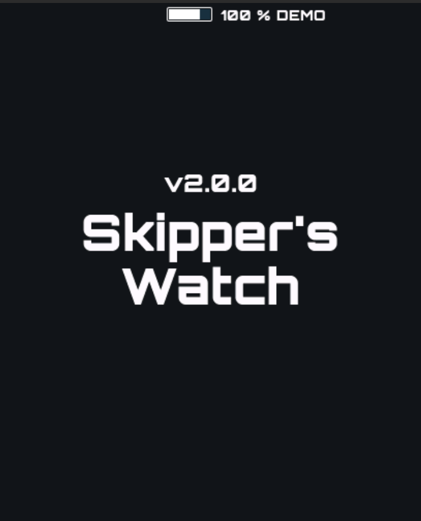

After a **true power-on** (the AXP2101 cut the power, e.g. after holding PWR for ~6 s, and a press brought it back) the watch shows its name and version (`ui_ContainerStartup`, `SW_VERSION` from `version.h`) for 3 s, then the last-active screen. A normal **deep-sleep wake opens the last screen directly**, so the startup screen tells at a glance that the watch was really off. The 3 s comes on top of the wake time: the display-on window starts only after it. The radio is already listening during it, so it doubles as the wake listen window.

## Input

All interaction is by touch; the PWR button is the wake source.

| Action | Gesture |
|---|---|
| Next screen | Swipe left |
| Previous screen | Swipe right |
| Open the page menu | Swipe down (on any screen) |
| Close the page menu, back to the last screen | Swipe up |
| Open the status screen | Swipe up (on any screen) |
| Close the status screen, back to the last screen | Swipe down |
| Jump to a screen | Tap its icon in the page menu |
| Screen action | Tap |
| Adjust brightness / wake time, toggle prevent sleep / demo / night | Drag a slider, tap a switch (Setup) |
| Wake from deep sleep | Press the **PWR** button (GPIO10, `ext0`) |

Screen carousel order:
- **Swipe left:** Navigation → Batteries → Weather → Engine → Attitude → Clock → Setup → Celestial → Navigation
- **Swipe right:** the reverse

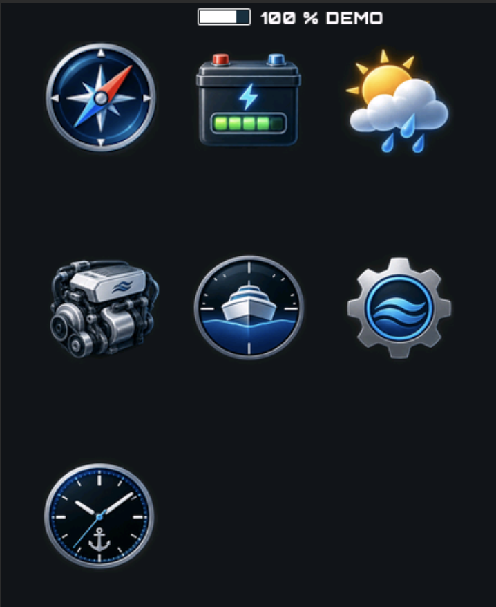 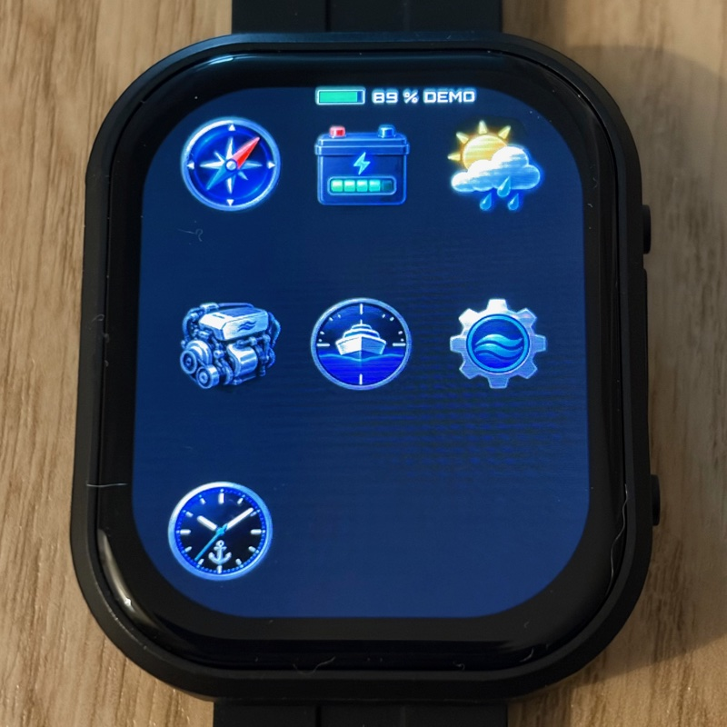

**Page menu.** A 3×3 grid of image buttons (`ui_ContainerMenu`), one per screen. It is an overlay, not a carousel page: opening it hides the current screen without leaving it, closing it brings that screen straight back, and it is never stored as the last-active screen. While it is open, swipes left / right and taps outside the icons do nothing, and no screen update runs underneath.

The last-active screen is restored on **every** boot, not just a deep-sleep wake. Two tiers: `RTC_NOINIT_ATTR` (free, always current) with an NVS backstop written once on the way into sleep. See [Last-active screen](#last-active-screen).

**Touch driver:** a small local FT3168 driver (`ft3168_touch`, I2C 0x38 on the bus shared with the AXP2101, SDA=GPIO15 / SCL=GPIO14), polled on the main loop. Gestures are recognized in software (`GestureClassifier`): the dominant axis of the net travel decides the swipe direction (ties go vertical), tap ≤ 27 px of travel, swipe ≥ 48 px. A short release grace keeps a held finger held across a single missed read. A page can claim a touch-down as a drag (the Setup slider), in which case no swipe is classified for it.

**Why not touch-to-wake:** the FT3168 interrupt line is GPIO38, which is not an RTC-capable pin, so it cannot wake the ESP32-S3 from deep sleep. The touch controller is hibernated before sleep instead.

**PWR button:** the same key is the AXP2101 power key. Holding it for about 6 s powers the board off in hardware, whatever the firmware does; a press then powers it on again as a cold boot.

### Status screen

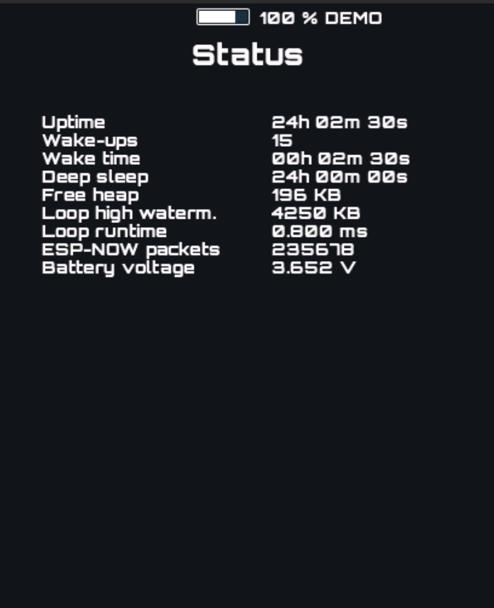 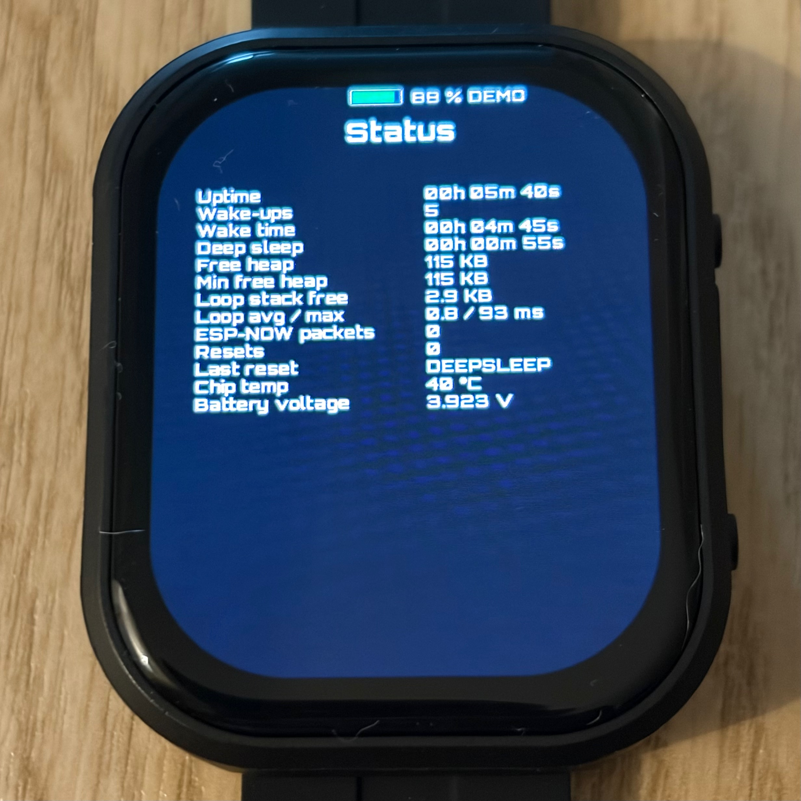

Swipe up on any screen for a status overlay; swipe down returns to the screen you came from. Like the page menu it sits outside the carousel, is never stored as the last-active screen, and ignores taps and sideways swipes. Menu and status open only from a screen, never from each other. Values refresh once per second.

| Row | Meaning | Source |
|---|---|---|
| Uptime | Time since the last true power-on, deep sleep included | ESP32 RTC timer (`esp_rtc_get_time_us()`), runs through deep sleep |
| Wake-ups | PWR-button wakes since power-on (stuck-button timer rechecks are not counted) | `RTC_NOINIT` counter |
| Wake time | Total awake time since power-on, the current wake included | `RTC_NOINIT` sum, added at every sleep entry, + `millis()` |
| Deep sleep | Uptime − wake time | derived |
| Free heap / Min free heap | Internal RAM free now / lowest during this wake | `heap_caps_*(MALLOC_CAP_INTERNAL)` |
| Loop stack free | Loop task stack never used during this wake | `uxTaskGetStackHighWaterMark()` |
| Loop avg / max | Main loop pass time during this wake (LVGL rendering included) | `micros()` per `loop()` |
| ESP-NOW packets | Valid radio frames since power-on (also counted in demo mode, where they are not shown) | receiver frame counter, `RTC_NOINIT` total |
| Resets | Watchdog, panic and brownout resets since power-on | `RTC_NOINIT` counter |
| Last reset | Reset reason of this boot (`POWERON`, `DEEPSLEEP`, `WDT`, `PANIC`, `BROWNOUT`, `SW`, …) | `esp_reset_reason()` |
| Chip temp | ESP32-S3 internal sensor (coarse) | `temperatureRead()` |
| Battery voltage | Watch cell, EMA-smoothed (the charge voltage while on USB) | AXP2101 |

All power-on counters survive deep sleep, watchdog, panic and software resets, and start over on a true power-on (AXP2101 power-off, flat or removed battery) — the same moment the RTC timer restarts and the [startup screen](#startup-screen) shows. Writing them costs no flash: they live in RTC RAM and are updated at sleep entry, the stuck-button recheck path included. Uptime and deep sleep follow the RTC slow clock, which can drift by roughly 1–2 %; wake time is `millis()`-exact. Over a battery cycle, wake time vs deep sleep gives the watch's actual duty cycle.

## Power management

The whole architecture resolves one contradiction: **in deep sleep the radio is off, so no ESP-NOW packet can be received.** You cannot both deep-sleep and listen.

**Model B (deep-sleep, wake-to-fetch).** Deep sleep is the resting default. A PWR-button press wakes the watch; only *then* does it bring the radio up, catch a broadcast, render, and — after a short display-on timeout (the Setup **wake time**, 2–20 s, default 10 s, shortened automatically as the cell empties) of no interaction — soft-ramp the brightness down and return to deep sleep. On sleep entry the AMOLED is switched off and put into sleep-in, the FT3168 into hibernate, the panel and touch reset lines are held high and the speaker amp enable (GPIO46) low through sleep; the PWR button (GPIO10, RTC-capable, **active-high**) is armed as the `ext0` wake source. The AXP2101 rails are left on for now: which load hangs on which rail is still to be traced, and cutting the wrong one could cut the SoC or the I2C pull-ups.

**Staggered wake (spike discipline).** A wake from deep sleep is the worst-timed current spike — several loads want to turn on at once on a small, possibly-aged cell. The bring-up spreads the inrush in time: release GPIO holds → PMIC + panel init (panel stays dark) → low-battery check → radio up first into the dark, low-load moment → ~200 ms dark ESP-NOW listen window so the first *lit* frame shows real data, not a placeholder flash → render → **then** the brightness ramps up (soft-start in panel-command steps, never a hard step). On a true power-on the [startup screen](#startup-screen) is lit (with the same soft ramp) in place of the dark listen window. The brownout detector is kept enabled — a trip means the sequence is too aggressive, not a reason to disable protection.

### Power guards

With a comfortable average budget, what actually threatens endurance is not the average draw but **failure modes** — a firmware bug or a stuck button that keeps the board awake at active current empties the cell in a few hours. Four guards, all owned by `PowerManager`:

| Guard | Value | Protects against |
|---|---|---|
| Absolute awake ceiling | 120 s | A stuck input source (bouncing button, latched touch INT, a UI path signalling activity every frame) holding the watch awake indefinitely. User activity **cannot** extend this ceiling — that is the whole point. Suspended on USB power |
| Task watchdog | 30 s | A *hung* loop, which the ceiling cannot catch because the ceiling itself needs the loop to run. A trip resets the SoC, i.e. a recoverable cold boot rather than a flat cell |
| Stuck wake-button guard | 30 s recheck | Deep-sleep `ext0` is **level-triggered**: arming it while the PWR button is already held (strap or sleeve pressure) makes the SoC wake immediately, over and over. The pin is read before arming (high = held) and, when held, a timer is armed instead; the recheck runs before any panel, UI or radio bring-up |
| Low-charge ladder | see below | Running the cell down to its own protection cutoff |

**Low-charge ladder.** `BatteryMonitor` classifies the charge and `PowerManager` acts on it. The level only ever escalates within one awake session, so a reading that jitters across a threshold under load cannot make the behaviour flap; a wake is a full reboot, so every wake re-evaluates from scratch. On USB power the ladder is suppressed entirely.

| Level | Trigger | Display timeout | Brightness ceiling |
|---|---|---|---|
| `OK` | SoC above 20 % | 10 s | 100 % |
| `WARN` | SoC 20 % or below | 5 s | 100 % (the status bar is already red) |
| `CRITICAL` | SoC 10 % or below | 3 s | 10 % |
| `CUTOFF` | SoC 5 % or below, **or** cell at/below 3400 mV | — | 5 %, then a `BATTERY EMPTY / CHARGE NOW` prompt for 2 s and a protective deep sleep |

On the CrowPanel, shortening the **timeout** was the real lever, not the brightness clamp, because the active baseline dominated the backlight. An AMOLED's draw depends on lit pixels and brightness instead, so which lever matters on this board is part of the open measurements; the constants are unchanged until then. The cutoff check deliberately runs *before* the radio is brought up — RF bring-up is the sharpest current edge on the board and the last thing a near-empty cell should be asked for. Button wake stays armed at cutoff on purpose: a press just repeats the short prompt cycle, and plugging in USB restores a normal boot, whereas refusing to wake would read as a bricked watch.

**On USB power the watch does not sleep.** With external power present (AXP2101 VBUS) there is no endurance to protect, so the display timeout and the awake ceiling are both suspended and the watch works as a docked display; after `STAYAWAKE_DIM_IDLE_MS` (60 s) without input the panel dims to `STAYAWAKE_DIM_PERCENT` (5 %) instead of sleeping. Unplugging grants a fresh display window and restarts the awake ceiling. The clamp is applied as a *ceiling* on what reaches the panel — the user's stored brightness and the Setup slider are never overwritten.

**The Setup screen's prevent-sleep switch is the battery-powered version of the same behaviour** — same dim, no display timeout — with one deliberate difference: the 120 s awake ceiling stays armed, and the low-charge ladder overrides the switch from `CRITICAL` down. See [Setup screen](#setup-screen) for the endurance cost.

### Freshness

A marine instrument that silently shows a minutes-old heading or depth is worse than one that shows nothing. On wake, all cached readings are treated as stale until a fresh broadcast lands; each source has its own RX timestamp, and depth additionally honours the payload's own `age_ms`. Placeholders (`---` / `--.-`) persist until real data arrives — the wake latency never entitles the UI to show a stale number.

### Last-active screen

The screen you were last on is restored on **every** boot, not only a deep-sleep wake — a reset button press, a watchdog trip, a panic, a flat cell or a disconnected battery all come back to the same page. Two tiers:

| Tier | Store | Survives | Cost |
|---|---|---|---|
| 1 | `RTC_NOINIT_ATTR` + magic word | deep sleep, software reset, watchdog, panic | none |
| 2 | NVS, written once at sleep entry | all of the above, plus power-on / flat cell / battery removal | ~5·10⁻⁶ mAh per sleep cycle |

`.rtc.noinit` matters here: the bootloader reloads `.rtc.data` (i.e. `RTC_DATA_ATTR`) from the flash image on every boot **except** a deep-sleep wake, where it deliberately skips the initialisation — so an `RTC_DATA_ATTR` value survives sleep but is wiped by a reset. `.rtc.noinit` is not in the image at all, so nothing initialises it; the magic word is what distinguishes a real value from the uninitialised RAM you get after a power-on.

Tier 2 is read **only** when tier 1 is gone, and written **only** when the page actually changed — so the common deep-sleep wake touches no flash and the wake sequence is unchanged. The write is placed at the top of the deep-sleep entry, before the brightness ramp, where the radio is idle and no render is in flight: one load moving at a time, the same spike-staggering rule the wake sequence follows. The restore is not gated on the wake cause (a reset reports `ESP_SLEEP_WAKEUP_UNDEFINED`); the magic word answers the real question, which is whether the stored value is trustworthy, and `ScreenManager::begin()` clamps it regardless.

Boot logs the reset reason and which tier supplied the page (`[page] reset=… src=rtc|nvs page=…`). On the CrowPanel that log showed the reset button wipes RTC RAM (`ESP_RST_POWERON`), which made the NVS tier load-bearing. On the Waveshare board the AXP2101 long-press power-off certainly does the same; how each of its buttons treats the RTC domain is to be confirmed from the same log.

### Consumption measurements

**Not yet measured on the Waveshare board.** No current figures are claimed for it until they are: the sleep floor and the active current decide the whole budget. To measure, battery only (USB unplugged):

- **Deep-sleep floor — series shunt + voltmeter.** A known resistor (e.g. 100 Ω) in series on battery `+`, bridged with a jumper while booting so the inrush bypasses it; once the watch sleeps, remove the jumper and read the voltage across the resistor. `I = U / R`.
- **Active current — DMM 10 A jack in series.** The mA ranges' burden voltage browns the board out; the 10 A range does not. Measure at several brightness levels on a typical (mostly black) screen.

For reference, v1.0.0 on the CrowPanel measured a **2.16 mA** deep-sleep floor and **~145 mA** active at 20 % backlight. Those numbers belong to that board and are not carried over.

### Endurance

Daily budget = sleep floor × 24 h + glances per day × active current × glance length (10 s window + ~0.5 s wake). The target is one to two days on the fitted cell (assumed ~300 mAh until confirmed) with nightly charging. The table is filled in once the floor and the active current have been measured.

On the CrowPanel, Model B met the 24 h + nightly-charge requirement with a 2.7–4.8× margin, so a hybrid light-sleep "watch mode" (Model C) was dropped; whether that still holds here follows from the measurements.

**The dominant endurance risk is not the average draw but a failure to sleep**: at active current a small cell is flat in hours. That is exactly what the awake ceiling, the task watchdog and the stuck-wake-button guard exist for — see [Power guards](#power-guards).

## ESP-NOW communication

All messages are wrapped in `ESPNowPacket`. The header carries a magic value identifying the fleet's own packets on the shared channel.

```cpp
static constexpr uint32_t ESPNOW_MAGIC = 0x45534E57; // 'E''S''N''W'

struct ESPNowHeader {
    uint32_t magic;           // ESPNOW_MAGIC
    uint8_t  msg_type;        // ESPNowMsgType
    uint8_t  payload_len;     // payload length in bytes (max 250)
    uint8_t  reserved[2];     // padding, set to zero
} __attribute__((packed));

template <typename TPayload>
struct ESPNowPacket {
    ESPNowHeader hdr;
    TPayload payload;
} __attribute__((packed));
```

`espnow_protocol.h` is a single fleet-wide file, copied verbatim into every project (senders and receivers). `ESPNowMsgType` is one shared number space. The watch **receives** types 1–9; type 10 (engine oil pressure) belongs to the fleet protocol but is not used by the watch, and frames of it are ignored:

```cpp
enum class ESPNowMsgType : uint8_t {
    HEADING_DELTA        = 1,  // CMPS14-ESP32-SignalK-gateway   (attitude)
    BATTERY_DELTA        = 2,  // VEDirect-ESP32-SignalK-gateway
    WEATHER_DELTA        = 3,  // BME280-ESP32-SignalK-gateway
    GNSS_DELTA           = 4,  // UBLOX-ESP32-SignalK-gateway
    HALMET_ENGINE_DELTA  = 5,  // HALMET-ESP32-SignalK-gateway
    HALMET_TANK_DELTA    = 6,  // HALMET-ESP32-SignalK-gateway   (fuel)
    HALMET_WATER_DELTA   = 7,  // HALMET-ESP32-SignalK-gateway   (fresh water)
    DEPTH_DELTA          = 8,  // SignalK-ESP-NOW-gateway        (relayed depth)
    DATETIME_DELTA       = 9,  // UBLOX-ESP32-SignalK-gateway    (UTC → system clock)
    HALMET_OIL_DELTA     = 10, // HALMET-ESP32-SignalK-gateway   (not used by the watch)
};
```

Key payloads used by the watch:

```cpp
struct GnssDelta {
    float lat_deg;        // Latitude, decimal degrees
    float lon_deg;        // Longitude, decimal degrees
    float sog_ms;         // Speed over ground, m/s
    float cog_true_rad;   // Course over ground (true), radians (NAN when stationary)
    float mag_var_rad;    // Magnetic variation (WMM), radians — NAN until first fix
    uint8_t satellites;   // SIV
    uint8_t fix_type;     // 0=no fix, 3=3D, 4=GNSS+DR
    uint8_t fix_ok;       // getGnssFixOk() ? 1 : 0
    uint8_t reserved;     // padding
};  // 24 bytes

struct DateTimeDelta {
    uint32_t unix_utc;     // seconds since 1970-01-01 00:00:00 UTC (leap-corrected by GNSS)
    uint8_t  time_valid;   // 1 = u-blox reports confirmed valid UTC date+time
    uint8_t  reserved[3];  // padding → 8 bytes
};  // 8 bytes

struct DepthDelta {
    float    below_surface_m;     // environment.depth.belowSurface [m]
    float    below_transducer_m;  // environment.depth.belowTransducer [m]
    float    below_keel_m;        // environment.depth.belowKeel [m]
    uint32_t age_ms;              // ms since the freshest of the three; UINT32_MAX = never received
};  // 16 bytes
```

(`HeadingDelta`, `BatteryDelta`, `WeatherDelta`, `HALMETEngineDelta`, `HALMETTankDelta`, `HALMETWaterDelta` are shared with the compass project — see `espnow_protocol.h`.) On the receiver side, `GnssDelta`/`HeadingDelta` are converted once into integer-scaled internal structs (`GnssData`/`HeadingData`); note that position-fix validity (`hasFix()`) and course validity (`hasCog()`) are kept **distinct**, so position and SOG remain visible at anchor even though COG is undefined.

**Channel:** all devices must share one WiFi channel. Configured to channel 6 (`static constexpr uint8_t ESP_NOW_CHANNEL = 6` in `WatchApplication.h`). Fix your router to channel 6 so senders can use WiFi and ESP-NOW simultaneously without channel-hopping.

## Project structure

| File(s) | Description |
|---------|-------------|
| `ESP32-Crowpanel-SkippersWatch.ino` | Owns `WatchApplication app`, contains `setup()` and `loop()` |
| `WatchApplication.h/.cpp` | Class `WatchApplication`, the "app" — owns all instances, display stack, staggered wake, gesture dispatch, GNSS time sync |
| `PowerManager.h/.cpp` | Class `PowerManager` — Model B deep-sleep, display timeout, peripheral sleep, PWR-button wake arming, and the power guards (awake ceiling, watchdog, low-charge ladder, stuck-button guard) |
| `BatteryMonitor.h/.cpp` | Class `BatteryMonitor` — AXP2101 battery voltage + fuel gauge, VBUS detection, status-bar indicator, charge-level classification |
| `BatteryLevel.h` | Charge levels, the low-charge ladder thresholds and the display-timeout cap (pure, host-tested) |
| `DemoSource.h/.cpp`, `DemoValues.h` | Class `DemoSource` — demo-mode frames injected into the receiver; `DemoValues` is the pure value generator (host-tested) |
| `ThemeController.h/.cpp`, `NightPalette.h` | Class `ThemeController` — day / night palette switch; `NightPalette` is the pure color mapping (host-tested) |
| `version.h` | Firmware version (`SW_VERSION`), shown on the startup screen |
| `SystemStats.h/.cpp`, `StatusFormat.h` | Class `SystemStats` — uptime and power-on counters across deep sleep; `StatusFormat` is the pure formatting and reset rule (host-tested) |
| `StatusUI.h/.cpp` | Class `StatusUI` — Status overlay and its once-per-second refresh |
| `PanelBrightness.h/.cpp` | Class `PanelBrightness` — AMOLED brightness as a panel command |
| `espnow_protocol.h` | Shared fleet wire protocol (namespace `ESPNow`): header, packet, `ESPNowMsgType`, all deltas + receiver-side `GnssData`/`HeadingData` |
| `IScreenUI.h` | Abstract base class for all UI adapter implementations (tap + touch-drag seam) |
| `ESPNowReceiver.h/.cpp` | Class `ESPNowReceiver` — ESP-NOW receive (receive-only), per-source freshness, demo-frame injection |
| `NavigationUI.h/.cpp` | Class `NavigationUI` — POS / HDG / COG / SOG / DPT, realizes `IScreenUI` |
| `BatteryUI.h/.cpp` | Class `BatteryUI` — battery screen adapter, realizes `IScreenUI` |
| `WeatherUI.h/.cpp` | Class `WeatherUI` — weather screen adapter, realizes `IScreenUI` |
| `EngineUI.h/.cpp` | Class `EngineUI` — exhaust + fuel/water tanks, realizes `IScreenUI` |
| `AttitudeUI.h/.cpp` | Class `AttitudeUI` — artificial horizon, realizes `IScreenUI` |
| `ClockUI.h/.cpp` | Class `ClockUI` — system-clock reader + formatting, realizes `IScreenUI` |
| `CelestialUI.h/.cpp`, `CelestialFormat.h` | Class `CelestialUI` — Celestial screen table and variables, realizes `IScreenUI`; `CelestialFormat` is the pure formatting (host-tested) |
| `CelestialEngine.h/.cpp` | Class `CelestialEngine` — astronomy task on core 0, active only while the Celestial screen is |
| `CelestialCalculator.h/.cpp`, `CelestialSelector.h/.cpp`, `NavStars.h/.cpp` | Geocentric Hc / Zn, rise / set and twilight; twilight body selection; the 57 navigational stars (pure, host-tested) |
| `astronomy.h/.c` | Astronomy Engine 2.1.19 (C), copied unchanged from ESP32-Crowpanel-compass |
| `SetupUI.h/.cpp` | Class `SetupUI` — brightness and wake-time sliders, prevent-sleep / demo / night switches (touch), realizes `IScreenUI` |
| `MenuUI.h/.cpp` | Class `MenuUI` — page menu overlay and its hit-testing |
| `TouchInput.h/.cpp` | Class `TouchInput` — touch polling, held/released state, drag points |
| `GestureClassifier.h` | Software gesture rules (pure, host-tested) |
| `ft3168_touch.h/.cpp` | Local FT3168 capacitive-touch driver (registers from Waveshare's `Arduino_FT3x68`) |
| `ScreenManager.h/.cpp` | Class `ScreenManager` — scalable screen carousel (container visibility) + direct jumps |
| `lv_conf.h` | LVGL configuration (project-local, `LV_COLOR_DEPTH 16`, `LV_MEM_SIZE` 96 kB) |
| `ui.h/.c`, `ui_ScreenMain.h/.c`, `ui_helpers.h/.c`, `ui_font_*.c`, `ui_img_*.c` | SquareLine Studio generated — UI, fonts and menu icons (day and night sets) |
| `tests/host/` | Host unit tests for the pure logic (`make -C tests/host`); not part of the sketch |
| `tests/celestial/` | Host tests for the celestial code against JPL Horizons and SIMBAD fixtures (`tests/celestial/run_tests.sh`) |
| `hardware_notes_waveshare.md` | Waveshare pin map, parts, build settings, open hardware questions |
| `hardware_notes.md` | CrowPanel (v1.0.0) pin map and measurements, kept for reference |
| `CHANGELOG.md` | Release history (Keep a Changelog / Semantic Versioning) |
| `SLS_project_WS/`, `SLS_export/` | SquareLine Studio project (410×502) and export directory; the v1.0.0 CrowPanel project is on `legacy/crowpanel` |
| `docs/` | Screenshots, diagrams, other documents |

## Hardware

### Bill of materials

1. [Waveshare ESP32-S3-Touch-AMOLED-2.06](https://docs.waveshare.com/ESP32-S3-Touch-AMOLED-2.06) (SKU 31957), having:
   - ESP32-S3R8 (dual LX7, 8 MB OPI PSRAM, 32 MB flash), native USB
   - 2.06" AMOLED 410×502, CO5300 driver over QSPI
   - FT3168 capacitive touch (I2C 0x38, INT=GPIO38, RST=GPIO9)
   - AXP2101 PMIC: charger, rails, fuel gauge, power key
   - PWR button (GPIO10 = SYS_OUT, high = pressed) and BOOT button (GPIO0)
   - QMI8658 IMU, PCF85063 RTC, ES8311/ES7210 audio, TF slot — not used (audio amp held off)
   - LiPo cell on an MX1.25 connector (capacity of the fitted cell to be confirmed; ~300 mAh assumed), factory case with strap
2. WiFi router set to a fixed channel 6
3. The ESP-NOW senders listed under [Integrated via ESP-NOW with](#esp32-skipperswatch)

**No paid partnerships.**

## Software

1. Arduino IDE 2.3.x
2. Espressif Systems esp32 board package 3.x (developed on 3.3.11)
3. Additional libraries:
   - LVGL 9.x (with a project-local `lv_conf.h`, `LV_COLOR_DEPTH 16`)
   - Arduino GFX Library 1.6.7 (contains `Arduino_CO5300`; no patch needed for this board — the `Arduino_GC9309` patch is only for the v1.0.0 CrowPanel build)
   - XPowersLib 0.3.x (Lewis He) for the AXP2101
4. SquareLine Studio for UI design and code generation
5. The ESP-NOW sender projects (see above)

## Installation

1. Clone the repo
   ```
   git clone https://github.com/mkvesala/ESP32-Waveshare-SkippersWatch.git
   ```
2. Install the required libraries in Arduino IDE: LVGL, GFX Library for Arduino, XPowersLib (see [Software](#software))
3. Set the ESP-NOW channel in `WatchApplication.h` to match your router:
   ```cpp
   static constexpr uint8_t ESP_NOW_CHANNEL = 6;
   ```
4. Configure the board (see [Flashing](#flashing)), connect USB-C
5. Compile and upload with Arduino IDE using these board settings:

   | Setting | Value |
   |---|---|
   | Board | ESP32S3 Dev Module |
   | USB CDC On Boot | **Enabled** |
   | USB Mode | Hardware CDC and JTAG |
   | Flash Size | **32MB (256Mb)** |
   | Partition Scheme | **Huge APP (3MB No OTA/1MB SPIFFS)** |
   | PSRAM | OPI PSRAM |
   | Flash Mode | QIO 80MHz |

   The sketch is ~1.88 MB, under 60 % of the Huge APP slot; the default 1.2 MB app partition is too small.
6. Point the ESP-NOW senders to the same WiFi channel

**Note** that `lv_conf.h` is project-local. If you use LVGL elsewhere, a second `lv_conf.h` may live under `Arduino/libraries/` next to the `lvgl` folder — check both to avoid conflicts.

**SquareLine Studio note:** SquareLine clears the export directory completely on export. Always git commit before exporting, and set a temporary export directory in project settings.

## Flashing

This board uses the ESP32-S3's **native USB** (no USB-UART bridge, no extra driver). Consequences:

- **`USB CDC On Boot` = Enabled**, so `Serial` is the native USB CDC port (the opposite of the v1.0.0 CrowPanel setting).
- On battery the watch spends most of its time in deep sleep, and **the USB port disappears while it sleeps**. On USB power it stays awake, so a watch that is already plugged in is normally reachable. To flash a sleeping watch, hold **BOOT** while plugging in USB, then upload.
- Early boot logs can be lost before the host re-enumerates the port; UART0 (GPIO43/44) is the fallback log channel.

## Security

**Use at your own risk — not for safety-critical navigation!**

This device receives data only via ESP-NOW broadcast on a local WiFi channel. There is no network server, no authentication and no sensitive data. Keep the device on a private boat WiFi network.

## Credits

Software and libraries used are documented in the sections above.

Companion project to my always-on helm display [ESP32-Crowpanel-compass](https://github.com/mkvesala/ESP32-Crowpanel-compass), and to the ESP-NOW sender projects [UBLOX-ESP32-SignalK-gateway](https://github.com/mkvesala/UBLOX-ESP32-SignalK-gateway), [CMPS14-ESP32-SignalK-gateway](https://github.com/mkvesala/CMPS14-ESP32-SignalK-gateway), [VEDirect-ESP32-SignalK-gateway](https://github.com/mkvesala/VEDirect-ESP32-SignalK-gateway), [BME280-ESP32-SignalK-gateway](https://github.com/mkvesala/BME280-ESP32-SignalK-gateway) and [HALMET-ESP32-SignalK-gateway](https://github.com/mkvesala/HALMET-ESP32-SignalK-gateway).

Board bring-up follows [Waveshare's example code](https://github.com/waveshareteam/ESP32-S3-Touch-AMOLED-2.06); the local `ft3168_touch` driver uses the register map of its `Arduino_FT3x68`. v1.0.0 was inspired by [example source code by Elecrow](https://github.com/Elecrow-RD/CrowPanel_2.01_inch-HMI_ESP32_Watch_Display_240_296).

<!-- TODO(credits): add icon/font attributions here if used in the UI -->

**No paid partnerships.**

Developed by Matti Vesala in collaboration with Claude.

## Gallery

<!-- TODO(images): add the UML diagram and a photo of the watch on the wrist here -->

The watch running v2.0.0:

| Navigation | Batteries | Weather |
|---|---|---|
|  |  |  |

| Engine | Attitude | Clock |
|---|---|---|
|  |  |  |

| Setup | Page menu | Status |
|---|---|---|
|  |  |  |

Night mode:

| Batteries | Setup | Page menu |
|---|---|---|
|  |  |  |

SquareLine Studio previews of the 410×502 layout:

| Navigation | Batteries | Weather |
|---|---|---|
|  |  |  |

| Engine | Attitude | Clock |
|---|---|---|
|  |  |  |

| Setup | Page menu | Status | Startup |
|---|---|---|---|
|  |  |  |  |
