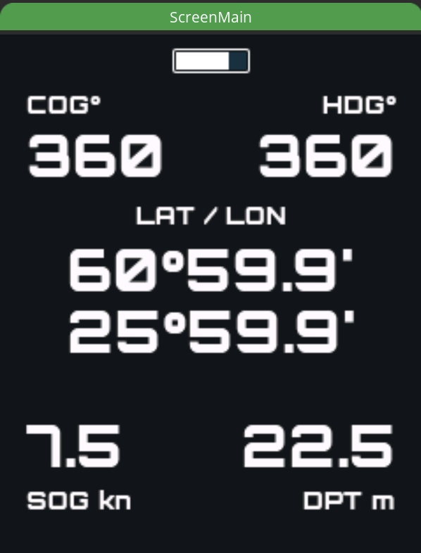
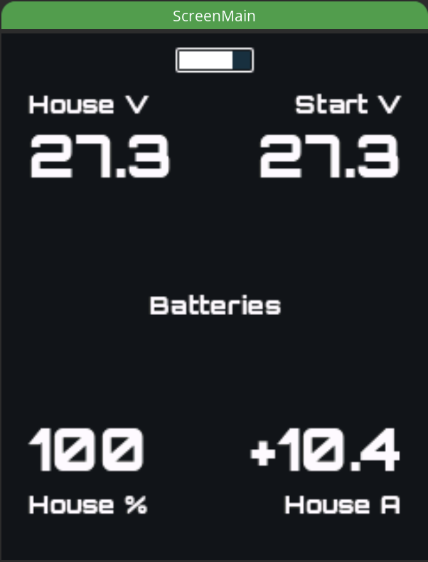
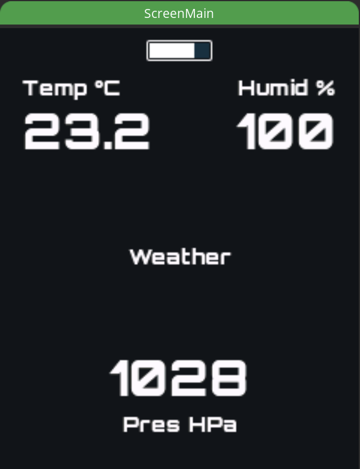
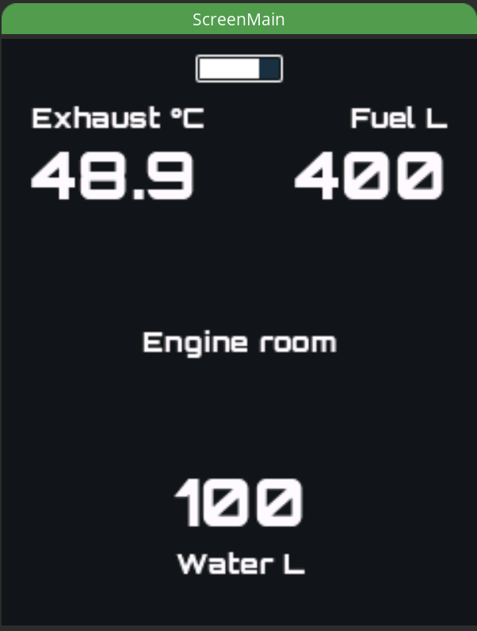
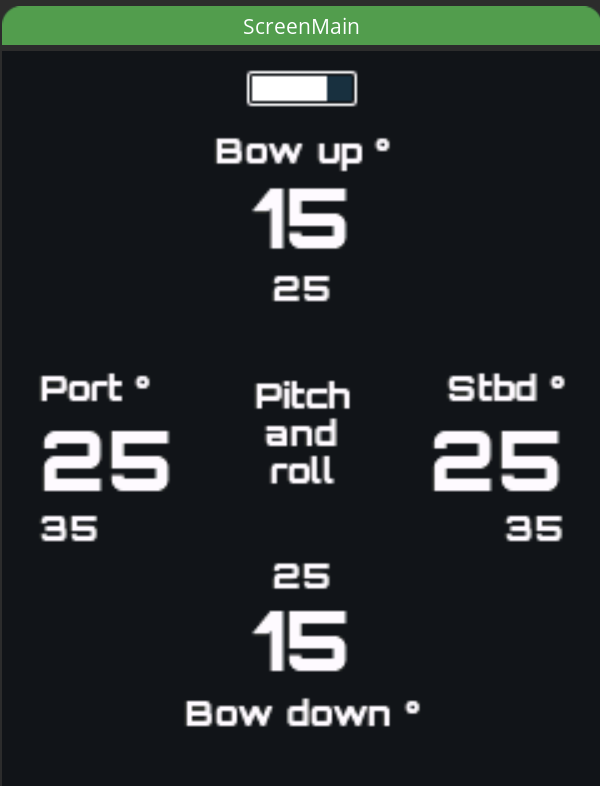
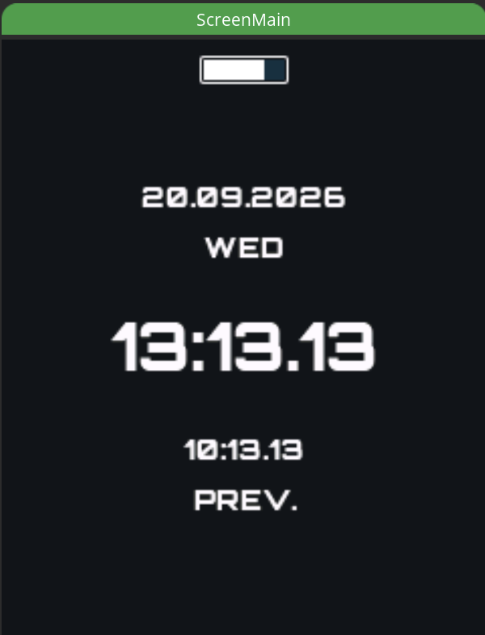
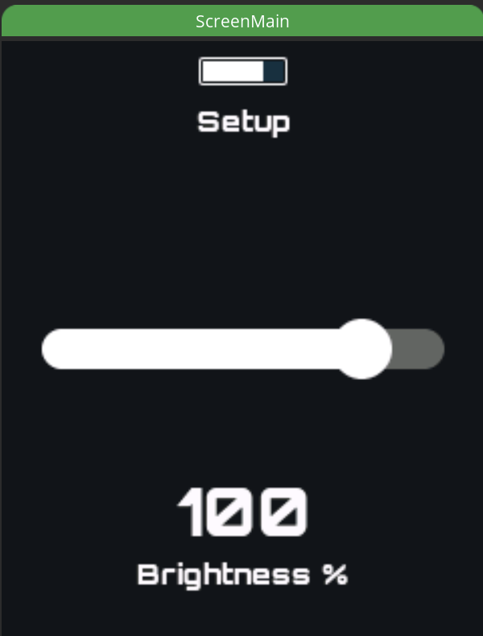

<!-- TODO(images): add project logo here, e.g.  -->

# ESP32 CrowPanel SkippersWatch

[](https://www.espressif.com/en/sdks/esp-arduino)
[](https://github.com/Elecrow-RD/CrowPanel_2.01_inch-HMI_ESP32_Watch_Display_240_296)
[](https://www.espressif.com/en/solutions/low-power-solutions/esp-now)
[](#power-management)
[](LICENSE)
[](https://lvgl.io)

A wrist-worn marine instrument for the [Elecrow CrowPanel 2.01" HMI ESP32 Watch Display](https://github.com/Elecrow-RD/CrowPanel_2.01_inch-HMI_ESP32_Watch_Display_240_296) (ESP32-S3, 240×296 IPS SPI touchscreen, rotary knob, ~250 mAh LiPo). It is the battery-powered sibling of my always-on [ESP32-Crowpanel-compass](https://github.com/mkvesala/ESP32-Crowpanel-compass) helm display — same receive-only ESP-NOW architecture, but rationed to run for days on a coin-cell-class battery and charged nightly.

Receives via ESP-NOW broadcast:
- GNSS position, speed over ground (SOG), course over ground (COG) and **UTC date/time** from [UBLOX-ESP32-SignalK-gateway](https://github.com/mkvesala/UBLOX-ESP32-SignalK-gateway)
- Water depth (below surface / transducer / keel), relayed from SignalK by [SignalK-ESP-NOW-gateway](https://github.com/mkvesala/SignalK-ESP-NOW-gateway)
- Pitch and roll from [CMPS14-ESP32-SignalK-gateway](https://github.com/mkvesala/CMPS14-ESP32-SignalK-gateway)
- House and starter battery from [VEDirect-ESP32-SignalK-gateway](https://github.com/mkvesala/VEDirect-ESP32-SignalK-gateway)
- Temperature, air pressure and relative humidity from [BME280-ESP32-SignalK-gateway](https://github.com/mkvesala/BME280-ESP32-SignalK-gateway)
- Engine exhaust temperature, fuel tank and fresh-water tank levels from [HALMET-ESP32-SignalK-gateway](https://github.com/mkvesala/HALMET-ESP32-SignalK-gateway)

Values are shown on an LVGL UI. Interaction is by **capacitive touch** (swipe / tap / slider drag) and, in parallel, by the **rotary knob** (rotate / press). The knob is retained mainly as the deep-sleep wake button; the touch layer is designed so the encoder can be removed later with no UI rewrite (see [Input](#input)).

Screens (carousel):
- **Navigation** — POS (lat/lon), COG, SOG, depth below surface (DPT)
- **Batteries** — house voltage / current / SoC and starter voltage
- **Weather** — temperature, air pressure, relative humidity
- **Engine** — exhaust temperature, fuel and fresh-water tank litres
- **Attitude** — artificial horizon with pitch and roll
- **Clock** — local date + weekday, local and UTC time (GNSS-disciplined, no RTC chip, no NTP)
- **Setup** — backlight brightness with NVS persistence

Developed and tested on:
- [Elecrow CrowPanel 2.01" HMI ESP32 Watch Display 240×296](https://github.com/Elecrow-RD/CrowPanel_2.01_inch-HMI_ESP32_Watch_Display_240_296)
- [ESP32 board package](https://github.com/espressif/arduino-esp32) (3.x — requires the `ledcAttach`/`ledcWrite` API)
- [Arduino IDE](https://www.arduino.cc/en/software/) (2.3.x)
- [LVGL](https://lvgl.io/) (9.x)
- [Arduino GFX Library](https://github.com/moononournation/Arduino_GFX) (1.6.7, patched with Elecrow's `Arduino_GC9309` driver — see [Software](#software))
- [SquareLine Studio](https://squareline.io/) for UI design

Integrated via ESP-NOW with:
- [UBLOX-ESP32-SignalK-gateway](https://github.com/mkvesala/UBLOX-ESP32-SignalK-gateway) — GNSS + UTC date/time sender
- [SignalK-ESP-NOW-gateway](https://github.com/mkvesala/SignalK-ESP-NOW-gateway) — depth relay
- [CMPS14-ESP32-SignalK-gateway](https://github.com/mkvesala/CMPS14-ESP32-SignalK-gateway) — attitude sender
- [VEDirect-ESP32-SignalK-gateway](https://github.com/mkvesala/VEDirect-ESP32-SignalK-gateway) — battery sender
- [BME280-ESP32-SignalK-gateway](https://github.com/mkvesala/BME280-ESP32-SignalK-gateway) — weather sender
- [HALMET-ESP32-SignalK-gateway](https://github.com/mkvesala/HALMET-ESP32-SignalK-gateway) — engine, fuel and fresh-water sender

## Purpose of the project

This is one of my individual digital boat projects. Use at your own risk. Not for safety-critical navigation.

1. I wanted a glanceable, wrist-worn repeater of the boat's key instruments, independent of WiFi and SignalK, that survives days on a tiny battery
2. I wanted to solve the core tension of a battery ESP-NOW device: **you cannot deep-sleep and listen at the same time** — the radio is off in deep sleep, so no packet can arrive
3. I continued learning ESP32 C++ patterns, LVGL and low-power design, reusing the architecture of the companion compass project

## Project status

**Version 1.0.0** (2026-09-04) — see [CHANGELOG.md](CHANGELOG.md).

Running on hardware on M/V Frida: all seven screens live, GNSS-disciplined clock live end-to-end, touch UI live, the power budget measured and closed, and the power guards in place (see [Power management](#power-management)).

## Classes

<!-- TODO(diagram): add class / UML diagram here, e.g.  -->

**`CrowPanelApplication`:**
- Owns: `Arduino_ESP32SPIDMA`, `Arduino_GC9309`, `ESPNowReceiver`, `NavigationUI`, `BatteryUI`, `WeatherUI`, `EngineUI`, `AttitudeUI`, `ClockUI`, `SetupUI`, `RotaryEncoder`, `TouchInput`, `ScreenManager`, `PowerManager`, `BatteryMonitor`
- Responsible for: orchestrating everything within the main program, including the staggered wake sequence and GNSS time discipline

**`PowerManager`:**
- Uses: `BatteryMonitor` (read-only, for the low-charge ladder and the USB stay-awake rule)
- Responsible for: Model B deep-sleep power ownership — display-on timeout, peripheral gating + GPIO holds on sleep entry, wake-source arming — and for all policy that can force a sleep decision: the absolute awake ceiling, the task watchdog, the low-charge ladder and the stuck-wake-button guard (see [Power guards](#power-guards))
- Owned by: `CrowPanelApplication`

**`BatteryMonitor`:**
- Responsible for: sampling the watch's own LiPo via the GPIO1 ADC, EMA smoothing, state-of-charge estimation from a LiPo resting curve, USB-power detection, driving the status-bar indicator, and classifying the charge into the `OK` / `WARN` / `CRITICAL` / `CUTOFF` level the power ladder acts on. Data only — the policy lives in `PowerManager`
- Owned by: `CrowPanelApplication`

**`ESPNowReceiver`:**
- Responsible for: receiving `GnssDelta`, `DateTimeDelta`, `HeadingDelta`, `BatteryDelta`, `WeatherDelta`, `HALMETEngineDelta`, `HALMETTankDelta`, `HALMETWaterDelta` and `DepthDelta` broadcasts (receive-only), with per-source RX timestamps for freshness
- Owned by: `CrowPanelApplication`

**`RotaryEncoder`:**
- Responsible for: reading knob rotation (Buxton quadrature decoder) and button press via FreeRTOS tasks; button (GPIO18) doubles as the deep-sleep wake source
- Owned by: `CrowPanelApplication`

**`TouchInput`:**
- Uses: `Axs5106lTouch` (local AXS5106L driver)
- Responsible for: polling the capacitive touch panel and recognizing gestures in software (tap / swipe up / swipe down; long-press reserved), feeding the same `IScreenUI` seam as the knob
- Owned by: `CrowPanelApplication`

**`IScreenUI`:**
- Abstract base class for all UI adapter class implementations. Input-source-agnostic: `onButtonPress()` / `onRotation()` (knob) plus `interceptsTouchAt()` / `onTouchDrag()` / `onTouchEnd()` (touch drag)

**`NavigationUI` / `BatteryUI` / `WeatherUI` / `EngineUI` / `AttitudeUI` / `ClockUI` / `SetupUI`:**
- Realize: `IScreenUI`
- Use: `ESPNowReceiver` (all data screens); `ClockUI` reads the ESP32 system clock; `SetupUI` uses `Preferences` (NVS)
- Responsible for: updating the LVGL objects of their container from the relevant data source, showing placeholders until a fresh packet arrives
- Owned by: `CrowPanelApplication`

**`ScreenManager`:**
- Depends on: `IScreenUI*`
- Responsible for: screen carousel management (containers on one LVGL screen, toggled via `LV_OBJ_FLAG_HIDDEN`)
- Owned by: `CrowPanelApplication`

## Features

Each screen is a container on a single LVGL screen. On wake, all cached values start as placeholders (`---` / `--.-`) and fill in only when a fresh ESP-NOW broadcast arrives — **stale data is never shown as if current** (see [Freshness](#freshness)).

### Status bar

Always visible above the screens: a bar showing the **watch's own LiPo** (distinct from the Batteries screen, which shows the boat's banks). Sampled from the GPIO1 ADC every ~3 s, EMA-smoothed and mapped to a state-of-charge through a LiPo resting curve.

| Indicator | Meaning |
|---|---|
| Green | above 40 % |
| Amber | above 20 %, up to 40 % |
| Red | 20 % or below — the low-charge ladder is active (see [Power guards](#power-guards)) |
| Blue, full | on USB power; the charger-elevated cell voltage is meaningless for SoC, so it is not estimated while charging |

### Navigation screen



- **POS** — latitude / longitude, shown only with a valid GNSS fix (blank until fix)
- **HDG** — heading, **true** (`heading_true_x10` from the CMPS14 sender, which applies the variation). Deliberately true rather than magnetic so it is directly comparable with the true COG beside it — a magnetic HDG next to a true COG reads as a ~11° crab angle that is not there
- **COG** — course over ground, true. `hasCog()`-gated: shown only when moving; blank at anchor (a stationary boat has a valid fix but undefined course)
- **SOG** — speed over ground in knots
- **DPT** — depth below surface (`below_surface_m`), the chosen single reference. Uses two-fold freshness: the ESP-NOW RX timestamp AND the depth payload's own `age_ms` (feed liveness) — either stale or NaN → `--.-`

### Batteries screen



- House bank voltage, current (negative = charging) and state-of-charge
- Starter battery voltage
- Source: `BatteryDelta` from a VE.Direct-based sender

### Weather screen



- Temperature (°C), air pressure (hPa), relative humidity (%)
- Source: `WeatherDelta` from a BME280-based sender

### Engine screen



- Exhaust temperature (°C, converted from Kelvin)
- Fuel tank litres and fresh-water tank litres (ratio × capacity; **M/V Frida: fuel 400 L, water 80 L**)
- Sources: `HALMETEngineDelta`, `HALMETTankDelta`, `HALMETWaterDelta`

### Attitude screen



- Artificial horizon plus pitch and roll value labels
- Source: `HeadingDelta` (pitch/roll) from the CMPS14 compass sender
- Session min/max markers were removed: the watch only receives packets during its short awake windows, so an extreme reached while it slept could never be observed. A meaningful "worst heel this trip" belongs in the always-powered CMPS14 gateway, not here

### Clock screen



- Local date `DD.MM.YYYY`, English 3-letter weekday
- Local and UTC time `HH:MM:SS` (24 h); a `PREV.`/`NEXT.` indicator appears under UTC when its calendar day differs from local
- **Timekeeping is ESP32-internal POSIX time** (`time.h`), Finland timezone `EET-2EEST,M3.5.0/3,M10.5.0/4`, disciplined by GNSS UTC over ESP-NOW (`DateTimeDelta` → `settimeofday()`). Survives deep sleep for free via the RTC timer
- Shows placeholders until synced (system year ≥ 2020) — a fabricated time is never displayed. No external RTC chip (PCF8563 deferred), no NTP (deliberately — no internet at anchor)

### Setup screen



**Touch-only.** The knob does not reach this screen: rotating it switches pages here like anywhere else, and a press does nothing. The slider position and the switch colour show the state directly, so the SquareLine value labels are hidden and never written.

**Backlight brightness** (`ui_SliderBrightness`) — drag the slider; applies instantly, saves to NVS on release. Range 2 %–100 % (the 2 % minimum keeps the screen from going fully dark); default 20 % (readable in daylight, low continuous draw), with the NVS-stored value always winning. Persistence: namespace `"display"`, key `"brightness"`. PWM: GPIO13, 5 kHz, 8-bit.

The power layer may apply a **ceiling** on top of the slider (low battery, or the stay-awake idle dim). It clamps only what reaches the backlight pin, never the stored setting, so the slider keeps showing your choice and it is restored the moment the ceiling lifts.

**Prevent sleep** (`ui_SwitchPreventSleep`) — tap to keep the watch awake on battery, the same way it stays awake while docked on USB: no display timeout, and the panel dims to 5 % after 60 s of no input instead of sleeping. Persistence: namespace `"display"`, key `"nosleep"`, saved the instant you flip it (`onLeave()` never runs on the way into deep sleep, so a later save would lose it). Red knob = off, green = on.

Two limits still apply, deliberately:

- **The 120 s awake ceiling is not suspended.** The switch suspends the display timeout, never the ceiling, so an awake session stays bounded — see [Power guards](#power-guards). USB is the only mode that lifts the ceiling, because on external power there is no endurance to protect.
- **The low-charge ladder overrides it from `CRITICAL` down** (SoC ≤ 10 %): the normal 3 s timeout and the 10 % backlight clamp come back. Your stored setting is not rewritten, so prevent sleep resumes by itself once the cell recovers — the same principle as the backlight ceiling.

**Cost.** With the switch on, every wake runs the full 120 s instead of timing out: ~4.7 mAh per wake (60 s at ~145 mA, then 60 s dimmed), roughly **11× a normal 0.42 mAh glance**. At 10 wakes/day that is ~99 mAh/day (~2.5 days); at 30, ~193 mAh/day (~1.3 days). The 24 h + nightly-charge requirement still holds, but the margin drops from ~3× to ~1.3× under heavy use — this is a "keep it awake while I am actively using it" switch, not a set-and-forget setting.

## Input

Touch and the rotary knob feed the **same** `IScreenUI` dispatch, so both drive the whole UI. Touch is additive; the encoder rotation is fully redundant and removable, leaving only the encoder's push-button as the (zero-standing-draw) wake source.

| Gesture / action | Touch | Knob |
|---|---|---|
| Next screen | Swipe up | Rotate CW |
| Previous screen | Swipe down | Rotate CCW |
| Screen action | Tap | Button press |
| Adjust brightness / toggle prevent sleep | Drag the slider, tap the switch | — (Setup is touch-only) |
| Wake from deep sleep | — (see note) | Button press (GPIO18, ext0) |

Screen carousel order:
- **Swipe up / knob CW:** Navigation → Batteries → Weather → Engine → Attitude → Clock → Setup → Navigation
- **Swipe down / knob CCW:** the reverse

The last-active screen is restored on **every** boot, not just a deep-sleep wake — a reset button press, a watchdog trip, a panic and even a flat cell or a disconnected battery all come back to the page you were on. Two tiers: `RTC_NOINIT_ATTR` (free, always current) with an NVS backstop written once on the way into sleep. See [Last-active screen](#last-active-screen).

**Touch driver:** the AXS5106L is interrupt-based (`readPoint()` returns a point only on a fresh INT). `TouchInput` debounces this event stream into a stable "held" state (80 ms release grace) so swipes and slider drags don't break up. Gestures are recognized in software — no dependence on any chip gesture register.

**Note on touch-wake:** waking from deep sleep by touch is *not* used — deep-sleep `ext1` is single-mode level-triggered and the AXS5106L INT rests low, so it can't be combined with the active-low button; it would work only via a light-sleep conversion (Elecrow's Lesson15 does exactly that), which isn't worth the refactor on a device that already meets its budget on the zero-draw encoder-button wake. The encoder button is the wake source.

## Power management

The whole architecture resolves one contradiction: **in deep sleep the radio is off, so no ESP-NOW packet can be received.** You cannot both deep-sleep and listen.

**Model B (deep-sleep, wake-to-fetch).** Deep sleep is the resting default. A button press wakes the watch; only *then* does it bring the radio up, catch a broadcast, render, and — after a short display-on timeout (`DISPLAY_TIMEOUT_MS = 10 s`, shortened automatically as the cell empties) of no interaction — soft-ramp the backlight down and return to deep sleep. On sleep entry the LCD rail (GPIO40), backlight (GPIO13) and shared peripheral rail (GPIO47) are driven off and GPIO-held through sleep; the encoder button (GPIO18, RTC-capable) is armed as the ext0 wake source.

**Staggered wake (spike discipline).** A wake from deep sleep is the worst-timed current spike — several loads want to turn on at once on a small, possibly-aged cell. The bring-up spreads the inrush in time: release GPIO holds → power rails + panel init (panel stays dark) → radio up first into the dark, low-load moment → ~200 ms dark ESP-NOW listen window so the first *lit* frame shows real data, not a placeholder flash → render → **then** the backlight ramps up (PWM soft-start, never a hard step). The brownout detector is kept enabled — a trip means the sequence is too aggressive, not a reason to disable protection.

### Power guards

The measured budget below is comfortable, so what actually threatens endurance is not the average draw but **failure modes** — a firmware bug or a stuck button that keeps the board awake at ~145 mA empties the 250 mAh cell in under two hours. Four guards, all owned by `PowerManager`:

| Guard | Value | Protects against |
|---|---|---|
| Absolute awake ceiling | 120 s | A stuck input source (bouncing button, latched touch INT, a UI path signalling activity every frame) holding the watch awake indefinitely. User activity **cannot** extend this ceiling — that is the whole point. Suspended on USB power |
| Task watchdog | 30 s | A *hung* loop, which the ceiling cannot catch because the ceiling itself needs the loop to run. A trip resets the SoC, i.e. a recoverable cold boot rather than a flat cell |
| Stuck wake-button guard | 30 s recheck | Deep-sleep `ext0` is **level-triggered**: arming it while the encoder button is already held (pocket pressure) makes the SoC wake immediately, over and over. The pin is read before arming and, when held, a timer is armed instead; the recheck runs before any rail, panel, UI or radio bring-up and costs ~0.003 mAh |
| Low-charge ladder | see below | Running the cell down to its own protection cutoff |

**Low-charge ladder.** `BatteryMonitor` classifies the charge and `PowerManager` acts on it. The level only ever escalates within one awake session, so a reading that jitters across a threshold under load cannot make the behaviour flap; a wake is a full reboot, so every wake re-evaluates from scratch. On USB power the ladder is suppressed entirely.

| Level | Trigger | Display timeout | Backlight ceiling |
|---|---|---|---|
| `OK` | SoC above 20 % | 10 s | 100 % |
| `WARN` | SoC 20 % or below | 5 s | 100 % (the status bar is already red) |
| `CRITICAL` | SoC 10 % or below | 3 s | 10 % |
| `CUTOFF` | SoC 5 % or below, **or** cell at/below 3400 mV | — | 5 %, then a `BATTERY EMPTY / CHARGE NOW` prompt for 2 s and a protective deep sleep |

Shortening the **timeout** is the real lever, not the brightness clamp: active baseline is ~145 mA while the backlight adds only ~10 mA at 20 %, so 10 s → 3 s saves roughly two-thirds per glance where the clamp saves about 5 %. The cutoff check deliberately runs *before* the radio is brought up — RF bring-up is the sharpest current edge on the board and the last thing a near-empty cell should be asked for. Button wake stays armed at cutoff on purpose: a press just repeats the short prompt cycle, and plugging in USB restores a normal boot, whereas refusing to wake would read as a bricked watch.

**On USB power the watch does not sleep.** With external power present (GPIO17) there is no endurance to protect, so the display timeout and the awake ceiling are both suspended and the watch works as a docked display; after `STAYAWAKE_DIM_IDLE_MS` (60 s) without input the panel dims to `STAYAWAKE_DIM_PERCENT` (5 %) instead of sleeping. Unplugging grants a fresh display window and restarts the awake ceiling. The clamp is applied as a *ceiling* on what reaches the backlight pin — the user's stored brightness and the Setup slider are never overwritten.

**The Setup screen's prevent-sleep switch is the battery-powered version of the same behaviour** — same dim, no display timeout — with one deliberate difference: the 120 s awake ceiling stays armed, and the low-charge ladder overrides the switch from `CRITICAL` down. See [Setup screen](#setup-screen) for the endurance cost.

### Freshness

A marine instrument that silently shows a minutes-old heading or depth is worse than one that shows nothing. On wake, all cached readings are treated as stale until a fresh broadcast lands; each source has its own RX timestamp, and depth additionally honours the payload's own `age_ms`. Placeholders (`---` / `--.-`) persist until real data arrives — the wake latency never entitles the UI to show a stale number.

### Last-active screen

The screen you were last on is restored on **every** boot, not only a deep-sleep wake — a reset button press, a watchdog trip, a panic, a flat cell or a disconnected battery all come back to the same page. Two tiers:

| Tier | Store | Survives | Cost |
|---|---|---|---|
| 1 | `RTC_NOINIT_ATTR` + magic word | deep sleep, software reset, watchdog, panic | none |
| 2 | NVS, written once at sleep entry | all of the above, plus power-on / flat cell / battery removal | ~5·10⁻⁶ mAh per sleep cycle |

`.rtc.noinit` matters here: the bootloader reloads `.rtc.data` (i.e. `RTC_DATA_ATTR`) from the flash image on every boot **except** a deep-sleep wake, where it deliberately skips the initialisation — so an `RTC_DATA_ATTR` value survives sleep but is wiped by a reset. `.rtc.noinit` is not in the image at all, so nothing initialises it; the magic word is what distinguishes a real value from the uninitialised RAM you get after a power-on.

Tier 2 is read **only** when tier 1 is gone, and written **only** when the page actually changed — so the common deep-sleep wake touches no flash and the wake sequence is unchanged. The write is placed at the top of the deep-sleep entry, before the backlight ramp, where the radio is idle and no render is in flight: one load moving at a time, the same spike-staggering rule the wake sequence follows. The restore is not gated on the wake cause (a reset reports `ESP_SLEEP_WAKEUP_UNDEFINED`); the magic word answers the real question, which is whether the stored value is trustworthy, and `ScreenManager::begin()` clamps it regardless.

Boot logs the reset reason and which tier supplied the page (`[page] reset=… src=rtc|nvs page=…`). That log settled a question the datasheets do not: on this board the **reset button wipes RTC RAM** — it reports `ESP_RST_POWERON` (1), not `ESP_RST_EXT`, because the button pulls EN (CHIP_PU) low and power-cycles the RTC domain with everything else. The NVS tier is therefore load-bearing rather than belt-and-braces; `RTC_NOINIT_ATTR` alone would not have survived the very case this feature exists for. See `hardware_notes.md`.

### Consumption measurements

Measured on the actual board with the battery as the only supply (**USB unplugged** — otherwise the USB-UART bridge and charger IC, both USB-powered, contaminate the reading). A plain handheld DMM (Velleman DVM850BL) can't measure the in-series milliamps directly — its burden voltage on the mA ranges browns the board out — so two indirect methods were used:

- **Deep-sleep floor — series shunt + voltmeter.** A known resistor in series on battery `+`; the board is booted with a jumper across it (so boot inrush bypasses the resistor), allowed to deep-sleep, then the jumper is removed and the voltage across the resistor is read. `I = U / R`. A 100 Ω shunt read **216 mV → 2.16 mA**.
- **Active current — DMM 10 A jack, in series.** The 10 A range's internal shunt is ~0.01 Ω, so its burden is negligible and the board runs normally (coarse ~10 mA resolution). Measured while continuously swiping (worst-case active).

| State | Current | Notes |
|---|---|---|
| Deep sleep (floor) | **2.16 mA** | Board-level standing draw (regulators / charger quiescent / touch + accel), ~50–200× the S3's intrinsic ~10–50 µA — the dev-board reality |
| Active, 9 % / 20 % backlight | ~0.14–0.15 A | Baseline: radio + S3 + SPI panel + touch + continuous render |
| Active, 50 % backlight | ~0.16–0.18 A | Backlight adds ~+25 mA |
| Active, 75 % backlight | ~0.18–0.19 A | Backlight adds ~+40 mA |
| Active, 95 % backlight | ~0.19–0.21 A | Backlight adds ~+55 mA |

Notable: during active use the panel + radio + render **baseline (~145 mA) dominates**, not the backlight (~55 mA max adder). But active time is tiny (glances), so the daily budget is dominated by the deep-sleep floor instead.

### Endurance

On the physical **250 mAh** cell (the largest that fits the case without modification), with a 24 h target and nightly charging. Daily sleep energy = 2.16 mA × 24 h = 51.8 mAh/day; each ~10.5 s glance (10 s window + ~0.5 s wake sequence) ≈ 0.42 mAh at ~145 mA active.

| Glances / day | mAh / day | Endurance | vs. 24 h target |
|---|---|---|---|
| 0 (pure sleep) | 51.8 | ~4.8 days | 4.8× |
| 30 | ~65 | ~3.9 days | 3.9× |
| 60 | ~77 | ~3.2 days | 3.2× |
| 100 | ~94 | ~2.7 days | 2.7× |

Sleep is ~55–80 % of the budget; even heavy glancing barely moves it. **Conclusion: Model B alone comfortably meets the 24 h + nightly-charge requirement with 2.7–4.8× margin.** A hybrid light-sleep "watch mode" (Model C) was considered but is not needed here and was dropped, and the 2.16 mA floor is not worth chasing lower for a 1-day requirement.

**The dominant endurance risk is not the average draw but a failure to sleep**: at ~145 mA the 250 mAh cell drains in under two hours. That is exactly what the awake ceiling, the task watchdog and the stuck-wake-button guard exist for — see [Power guards](#power-guards).

## ESP-NOW communication

All messages are wrapped in `ESPNowPacket`. The header carries a magic value identifying the fleet's own packets on the shared channel.

```cpp
template <typename TPayload>
struct ESPNowPacket {
    ESPNowHeader hdr;
    TPayload payload;
} __attribute__((packed));

struct ESPNowHeader {
    uint32_t magic;           // ESPNOW_MAGIC ('E''S''N''W' = 0x45534E57)
    uint8_t  msg_type;        // ESPNowMsgType
    uint8_t  payload_len;     // payload length in bytes (max 250)
    uint8_t  reserved[2];     // padding, set to zero
} __attribute__((packed));
```

`espnow_protocol.h` is a single fleet-wide file, copied verbatim into every project (senders and receivers). `ESPNowMsgType` is one shared number space — the watch **receives** these types:

```cpp
enum class ESPNowMsgType : uint8_t {
    HEADING_DELTA        = 1,  // CMPS14-ESP32-SignalK-gateway   (attitude)
    BATTERY_DELTA        = 2,  // VEDirect-ESP32-SignalK-gateway
    WEATHER_DELTA        = 3,  // BME280-ESP32-SignalK-gateway
    GNSS_DELTA           = 4,  // UBLOX-ESP32-SignalK-gateway
    HALMET_ENGINE_DELTA  = 5,  // HALMET-ESP32-SignalK-gateway
    HALMET_TANK_DELTA    = 6,  // HALMET-ESP32-SignalK-gateway   (fuel)
    HALMET_WATER_DELTA   = 7,  // HALMET-ESP32-SignalK-gateway   (fresh water)
    DEPTH_DELTA          = 8,  // SignalK-ESP-NOW-gateway        (relayed depth)
    DATETIME_DELTA       = 9,  // UBLOX-ESP32-SignalK-gateway    (UTC → system clock)
};
```

Key payloads used by the watch:

```cpp
struct GnssDelta {
    float lat_deg;        // Latitude, decimal degrees
    float lon_deg;        // Longitude, decimal degrees
    float sog_ms;         // Speed over ground, m/s
    float cog_true_rad;   // Course over ground (true), radians — NaN when stationary
    float mag_var_rad;    // Magnetic variation (WMM), radians — NaN until first fix
    uint8_t satellites;   // SIV
    uint8_t fix_type;     // 0=no fix, 3=3D, 4=GNSS+DR
    uint8_t fix_ok;       // getGnssFixOk() ? 1 : 0
    uint8_t reserved;
};  // 24 bytes

struct DateTimeDelta {
    uint32_t unix_utc;    // seconds since 1970-01-01 UTC (leap-corrected by GNSS)
    uint8_t  time_valid;  // 1 = u-blox reports confirmed valid UTC date+time
    uint8_t  reserved[3]; // padding → 8 bytes
};  // 8 bytes

struct DepthDelta {
    float    below_surface_m;     // environment.depth.belowSurface [m]
    float    below_transducer_m;  // environment.depth.belowTransducer [m]
    float    below_keel_m;        // environment.depth.belowKeel [m]
    uint32_t age_ms;              // ms since the freshest of the three; UINT32_MAX = never received
};  // 16 bytes
```

(`HeadingDelta`, `BatteryDelta`, `WeatherDelta`, `HALMETEngineDelta`, `HALMETTankDelta`, `HALMETWaterDelta` are shared with the compass project — see `espnow_protocol.h`.) On the receiver side, `GnssDelta`/`HeadingDelta` are converted once into integer-scaled internal structs (`GnssData`/`HeadingData`); note that position-fix validity (`hasFix()`) and course validity (`hasCog()`) are kept **distinct**, so position and SOG remain visible at anchor even though COG is undefined.

**Channel:** all devices must share one WiFi channel. Configured to channel 6 (`static constexpr uint8_t ESP_NOW_CHANNEL = 6` in `CrowPanelApplication.h`). Fix your router to channel 6 so senders can use WiFi and ESP-NOW simultaneously without channel-hopping.

## Project structure

| File(s) | Description |
|---------|-------------|
| `ESP32-Crowpanel-SkippersWatch.ino` | Owns `CrowPanelApplication app`, contains `setup()` and `loop()` |
| `CrowPanelApplication.h/.cpp` | Class `CrowPanelApplication`, the "app" — owns all instances, staggered wake, GNSS time sync |
| `PowerManager.h/.cpp` | Class `PowerManager` — Model B deep-sleep, display timeout, peripheral gating, wake arming, and the power guards (awake ceiling, watchdog, low-charge ladder, stuck-button guard) |
| `BatteryMonitor.h/.cpp` | Class `BatteryMonitor` — watch LiPo ADC sampling, SoC estimation, USB detection, status-bar indicator, charge-level classification |
| `espnow_protocol.h` | Shared fleet wire protocol (namespace `ESPNow`): header, packet, `ESPNowMsgType`, all deltas + receiver-side `GnssData`/`HeadingData` |
| `IScreenUI.h` | Abstract base class for all UI adapter implementations (knob + touch seam) |
| `ESPNowReceiver.h/.cpp` | Class `ESPNowReceiver` — ESP-NOW receive (receive-only), per-source freshness |
| `NavigationUI.h/.cpp` | Class `NavigationUI` — POS / COG / SOG / DPT, realizes `IScreenUI` |
| `BatteryUI.h/.cpp` | Class `BatteryUI` — battery screen adapter, realizes `IScreenUI` |
| `WeatherUI.h/.cpp` | Class `WeatherUI` — weather screen adapter, realizes `IScreenUI` |
| `EngineUI.h/.cpp` | Class `EngineUI` — exhaust + fuel/water tanks, realizes `IScreenUI` |
| `AttitudeUI.h/.cpp` | Class `AttitudeUI` — artificial horizon, realizes `IScreenUI` |
| `ClockUI.h/.cpp` | Class `ClockUI` — system-clock reader + formatting, realizes `IScreenUI` |
| `SetupUI.h/.cpp` | Class `SetupUI` — brightness slider + adjust state machine (knob) + touch drag, realizes `IScreenUI` |
| `RotaryEncoder.h/.cpp` | Class `RotaryEncoder` — knob rotation (quadrature) + button, FreeRTOS tasks |
| `TouchInput.h/.cpp` | Class `TouchInput` — touch polling + software gesture recognition |
| `axs5106l_touch.h/.cpp` | Local AXS5106L capacitive-touch driver (ported from Elecrow's Lesson03 example) |
| `ScreenManager.h/.cpp` | Class `ScreenManager` — scalable screen carousel (container visibility) |
| `lv_conf.h` | LVGL configuration (project-local, `LV_COLOR_DEPTH 16`) |
| `ui.h/.c`, `ui_ScreenMain.h/.c`, `ui_helpers.h/.c`, `ui_font_*.c` | SquareLine Studio generated — UI + fonts |
| `hardware_notes.md` | Authoritative pin map + build/toolchain notes + power-guard reference |
| `CHANGELOG.md` | Release history (Keep a Changelog / Semantic Versioning) |
| `SLS_project/`, `SLS_export/` | SquareLine Studio project and export |
| `docs/` | Screenshots, diagrams, other documents |

## Hardware

### Bill of materials

1. [Elecrow CrowPanel 2.01" HMI ESP32 Watch Display 240×296](https://github.com/Elecrow-RD/CrowPanel_2.01_inch-HMI_ESP32_Watch_Display_240_296), having:
   - ESP32-S3R8 module (dual LX7, 8 MB PSRAM, 16 MB flash)
   - 240×296 IPS SPI display (GC9309)
   - AXS5106L capacitive touch (I2C, INT=GPIO2, RST=GPIO5)
   - ALPS EC11 rotary encoder with push button (A=GPIO20, B=GPIO19, button=GPIO18)
   - SC7A20H 3-axis accelerometer (I2C 0x19) — not used yet
   - Vibration motor (GPIO45) — not used yet
   - ~250 mAh LiPo cell, USB-C charging via a CH34x USB-UART bridge
2. WiFi router set to a fixed channel 6
3. The ESP-NOW senders listed under [Integrated via ESP-NOW with](#esp32-crowpanel-skipperswatch)

**No paid partnerships.**

## Software

1. Arduino IDE 2.3.x
2. Espressif Systems esp32 board package 3.x
3. Additional libraries:
   - LVGL 9.x (with a project-local `lv_conf.h`, `LV_COLOR_DEPTH 16`)
   - Arduino GFX Library 1.6.7 — **patched** with Elecrow's `Arduino_GC9309.{h,cpp}` (mainline GFX has no GC9309; drop the driver into `src/display/` and add its include to `src/Arduino_GFX_Library.h`; re-apply if the library is reinstalled)
4. SquareLine Studio for UI design and code generation
5. The ESP-NOW sender projects (see above)

## Installation

1. Clone the repo
   ```
   git clone https://github.com/mkvesala/ESP32-Crowpanel-SkippersWatch.git
   ```
2. Install the required libraries in Arduino IDE (LVGL, Arduino_GFX_Library) and apply the `Arduino_GC9309` patch to the GFX library (see [Software](#software))
3. Set the ESP-NOW channel in `CrowPanelApplication.h` to match your router:
   ```cpp
   static constexpr uint8_t ESP_NOW_CHANNEL = 6;
   ```
4. Configure the board (see [Flashing](#flashing)), connect USB-C
5. Compile and upload with Arduino IDE (board: ESP32S3 Dev Module, PSRAM: OPI, Flash: 16 MB / QIO 80 MHz, **Partition Scheme: Huge APP (3 MB No OTA/1 MB SPIFFS)**)

   The partition scheme matters: at ~1.30 MB the sketch leaves under 12 kB of headroom in the default 1.2 MB app partition (99 % full — it links, but the next small change overflows it). With Huge APP it uses about 41 %.
6. Point the ESP-NOW senders to the same WiFi channel

**Note** that `lv_conf.h` is project-local. If you use LVGL elsewhere, a second `lv_conf.h` may live under `Arduino/libraries/` next to the `lvgl` folder — check both to avoid conflicts.

**SquareLine Studio note:** SquareLine clears the export directory completely on export. Always git commit before exporting, and set a temporary export directory in project settings.

## Flashing

This board's USB-C connector is a **CH34x USB-UART bridge** on UART0 — **not** the S3's native USB. Consequences:

- macOS/Windows need the **WCH CH34x driver** installed; without it no serial port appears even though the S3 is running. The port enumerates as WCH VID `0x1a86` (e.g. `/dev/cu.wchusbserial*`).
- Set **`USB CDC On Boot` = Disabled**, so `Serial` maps to UART0 → CH34x and the Serial Monitor works.
- Upload uses the bridge's DTR/RTS auto-reset (no manual BOOT+RESET normally needed). Fallback on "Failed to connect": hold **BOOT (GPIO0)** → tap **RESET** → release BOOT → Upload.
- The CH34x port persists across firmware deep-sleep (the bridge is independent of the S3).

## Security

**Use at your own risk — not for safety-critical navigation!**

This device receives data only via ESP-NOW broadcast on a local WiFi channel. There is no network server, no authentication and no sensitive data. Keep the device on a private boat WiFi network.

## Credits

Software and libraries used are documented in the sections above.

Companion project to my always-on helm display [ESP32-Crowpanel-compass](https://github.com/mkvesala/ESP32-Crowpanel-compass), and to the ESP-NOW sender projects [UBLOX-ESP32-SignalK-gateway](https://github.com/mkvesala/UBLOX-ESP32-SignalK-gateway), [SignalK-ESP-NOW-gateway](https://github.com/mkvesala/SignalK-ESP-NOW-gateway), [CMPS14-ESP32-SignalK-gateway](https://github.com/mkvesala/CMPS14-ESP32-SignalK-gateway), [VEDirect-ESP32-SignalK-gateway](https://github.com/mkvesala/VEDirect-ESP32-SignalK-gateway), [BME280-ESP32-SignalK-gateway](https://github.com/mkvesala/BME280-ESP32-SignalK-gateway) and [HALMET-ESP32-SignalK-gateway](https://github.com/mkvesala/HALMET-ESP32-SignalK-gateway).

Inspired by [example source code by Elecrow](https://github.com/Elecrow-RD/CrowPanel_2.01_inch-HMI_ESP32_Watch_Display_240_296). The local `axs5106l_touch` driver is adapted from Elecrow's Lesson03 example.

<!-- TODO(credits): add icon/font attributions here if used in the UI -->

**No paid partnerships.**

Developed by Matti Vesala in collaboration with Claude.

## Gallery

<!-- TODO(images): add the UML diagram and a photo of the watch on the wrist here -->

| Navigation | Batteries | Weather |
|---|---|---|
|  |  |  |

| Engine | Attitude | Clock |
|---|---|---|
|  |  |  |

| Setup |
|---|
|  |
